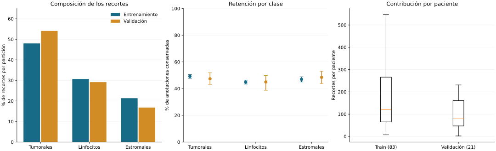
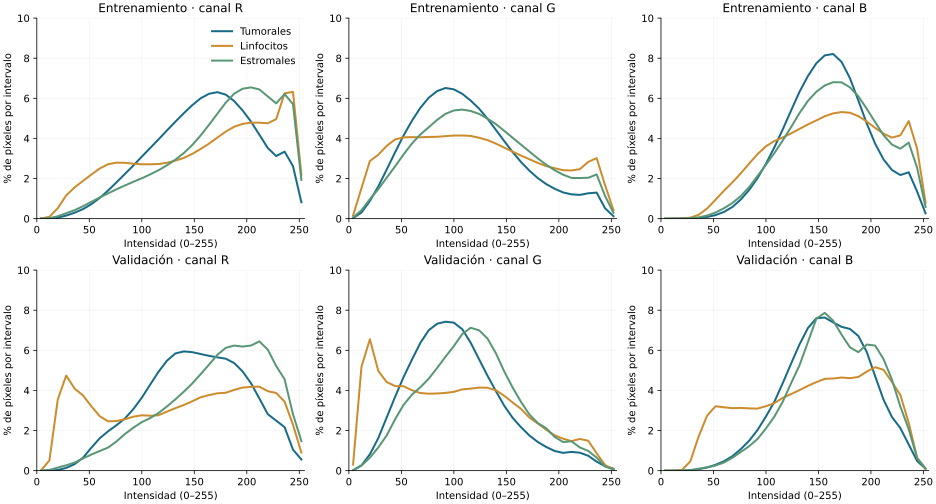
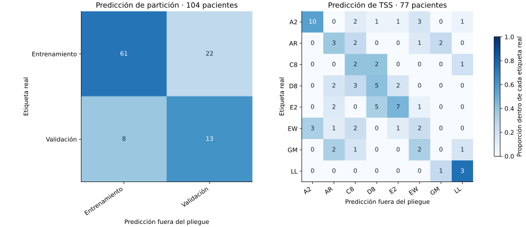

# Desarrollo v2: composición y retención

La nueva partición contiene 14.539 recortes de entrenamiento, correspondientes a 83 pacientes, y 2.049 de validación, de 21 pacientes. Los pacientes y los códigos TSS son disjuntos entre grupos. Este análisis utiliza metadatos de esas dos particiones y no calcula predicciones ni medidas de rendimiento sobre la reserva.

## Composición de los grupos

| Clase | Entrenamiento | Proporción | Validación | Proporción |
|---|---:|---:|---:|---:|
| Tumoral no mitótica | 6.977 | 47,99% | 1.108 | 54,08% |
| Linfocito | 4.460 | 30,68% | 597 | 29,14% |
| Estromal | 3.102 | 21,34% | 344 | 16,79% |

La proporción tumoral aumenta 6,09 puntos porcentuales en validación y la estromal disminuye 4,55. Por tanto, la exactitud global depende de una composición distinta en cada grupo. Macro-F1 conserva el mismo peso para las tres categorías, pero no elimina cambios de dominio ni diferencias entre pacientes. Su interpretación debe acompañarse de sensibilidad, precisión y F1 por clase.

## Selección de ventanas interiores

| Clase | Retención en entrenamiento | IC95% por paciente | Retención en validación | IC95% por paciente |
|---|---:|---:|---:|---:|
| Tumoral no mitótica | 49,18% | 47,64–50,51% | 47,35% | 43,15–51,83% |
| Linfocito | 44,84% | 43,44–46,29% | 44,99% | 38,72–49,80% |
| Estromal | 46,94% | 44,98–48,87% | 48,45% | 43,83–53,03% |

La retención se calcula sobre las anotaciones de cada clase antes de las exclusiones geométricas. En entrenamiento se conserva una proporción menor de linfocitos que de núcleos tumorales: una diferencia descriptiva de 4,34 puntos. La regla espacial modifica así la composición de la muestra. Los resultados posteriores corresponderán a núcleos con una ventana interior elegible, sin generalización automática a núcleos periféricos.

Los intervalos proceden de 5.000 remuestreos de pacientes, con semilla 4101, conservando juntas sus anotaciones. En cada repetición se calcula la razón entre recortes retenidos y anotaciones originales. Son intervalos percentiles, condicionados a los TSS observados; no describen la incertidumbre entre centros ni prueban una diferencia entre clases.

## Contribución de cada paciente

La mediana es de 121 recortes por paciente en entrenamiento, con rango de 7 a 547, y de 79 en validación, con rango de 2 a 231. El conjunto no aporta la misma cantidad de observaciones por paciente. Una métrica calculada sobre todos los recortes otorga mayor influencia a quienes aportan más imágenes. El análisis de incertidumbre por paciente reconoce esa dependencia y complementa la variabilidad entre semillas; ambos componentes responden a preguntas distintas.

## Intensidad y variabilidad de los recortes

Se analizaron los píxeles de los 16.588 recortes de desarrollo, con verificación de dimensiones RGB 128×128 y hashes frente al manifiesto. Las estadísticas de normalización se estimaron exclusivamente en entrenamiento, sobre 238.206.976 píxeles por canal.

| Canal | Media en escala 0–1 | Desviación estándar |
|---|---:|---:|
| Rojo | 0,63920 | 0,21397 |
| Verde | 0,45917 | 0,22150 |
| Azul | 0,62775 | 0,17429 |

La media del canal verde es inferior a las de rojo y azul. La distribución no es equivalente entre canales: una transformación que centre y escale cada uno debe utilizar sus parámetros de entrenamiento. Esta operación no normaliza la tinción ni elimina variación de adquisición. Los valores corresponden a recortes nucleares con contexto; no son mediciones exclusivas del núcleo ni medidas cuantitativas de hematoxilina o eosina.

Cada curva representa la proporción de píxeles por intervalo dentro de una clase y partición. La normalización permite comparar la forma de las distribuciones sin confundirla con el número de recortes. Los histogramas contienen tanto el núcleo objetivo como su entorno; sus diferencias no pueden atribuirse exclusivamente a morfología celular o a tinción.

## Desplazamiento entre particiones y señal de procedencia

Se construyeron diez descriptores de color y textura por recorte. Para evitar que los pacientes con más imágenes dominaran el diagnóstico, se utilizó la mediana de cada descriptor por paciente. Una regresión logística con pesos balanceados se evaluó en tres pliegues, manteniendo cada paciente en un único grupo y estimando el escalado dentro de entrenamiento. Los hiperparámetros se fijaron antes de la ejecución, sin búsqueda.

| Diagnóstico | Pacientes | Categorías | Exactitud balanceada | AUC |
|---|---:|---:|---:|---:|
| Entrenamiento frente a validación | 104 | 2 | 0,6770 | 0,7097 |
| TSS entre pacientes de entrenamiento | 77 | 8 | 0,3983 | No calculada |

La clasificación de partición reconoció 61 de 83 pacientes de entrenamiento y 13 de 21 de validación. Su AUC de 0,7097 describe señal disponible en estos descriptores para distinguir los grupos. No se presenta como prueba confirmatoria: el diagnóstico carece de intervalo de confianza y puede reflejar conjuntamente diferencias de composición celular, tejido, adquisición y procedencia. La separación por TSS evita compartir esos códigos entre grupos, pero no garantiza distribuciones visuales equivalentes.

El diagnóstico de procedencia incluyó únicamente los ocho TSS de entrenamiento con al menos tres pacientes. Su exactitud balanceada de 0,3983 supera descriptivamente la referencia uniforme de 0,125 para ocho categorías. Esto indica que los descriptores contienen señal asociada al TSS; no demuestra que una CNN entrenada para clasificar núcleos utilice esa señal. Tampoco estima rendimiento en TSS nuevos. Se mantiene la separación por paciente y TSS, y se evita interpretar la normalización RGB como solución demostrada a este desplazamiento.

## Similitud perceptual entre entrenamiento y validación

Se compararon 29.790.411 pares de recortes mediante dHash de 64 bits. No se identificaron candidatos con distancia de Hamming menor o igual a cuatro. La comparación fue recalculada de forma independiente a partir de los hashes exportados. El resultado complementa la comprobación de duplicados exactos, pero no descarta todas las rotaciones, cambios de escala, recortes parcialmente solapados ni otras similitudes que este descriptor puede omitir. No se eliminaron imágenes por este análisis.

## Procedencia y alcance de la verificación

El procesamiento de píxeles se ejecutó en el equipo del autor. La segunda verificación contrastó los 16.588 registros con el manifiesto, recalculó medias y desviaciones RGB mediante los descriptores, comprobó los conteos de los histogramas y reconstruyó las matrices de confusión y sus exactitudes balanceadas. La AUC adversarial se conserva tal como la registró el script: el archivo exporta etiquetas predichas, pero no sus probabilidades, por lo que esa AUC no se recalculó de forma independiente. No se recibieron los píxeles en esta segunda revisión.

No se utilizaron imágenes de reserva. Las mediciones de calidad de campos del piloto se conservan en su apartado original y no se atribuyen a los recortes de esta nueva partición.
