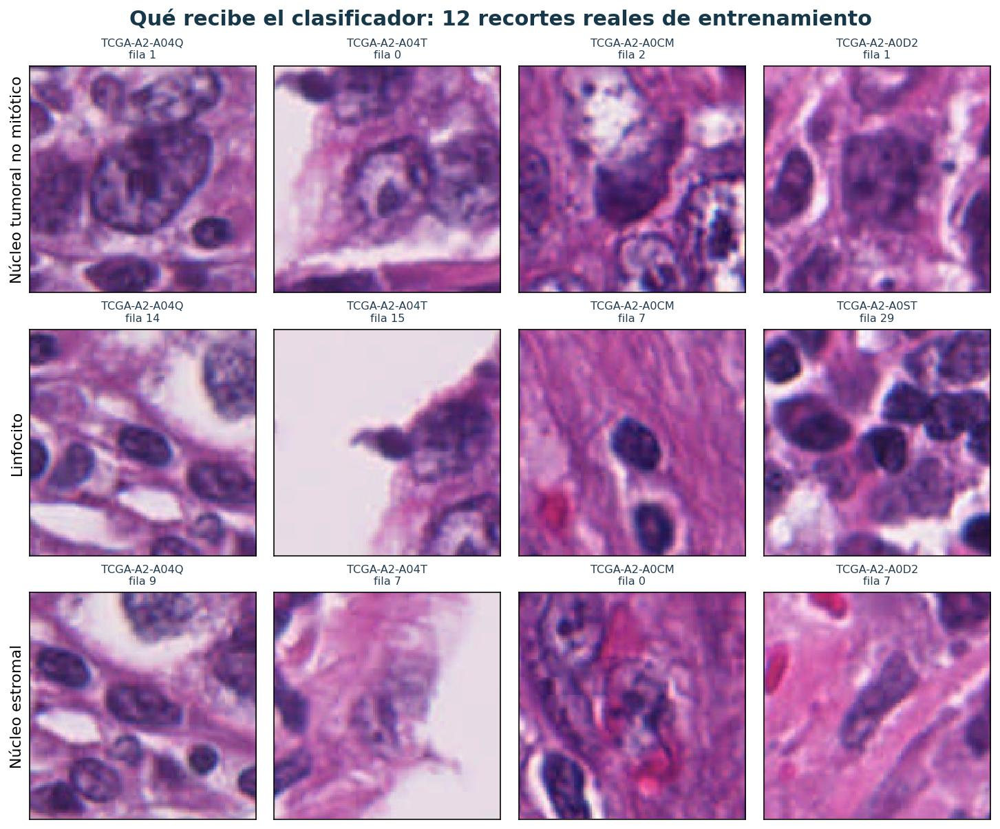

# Qué ve la red: imágenes y preparación

<strong>Idea central.</strong> La unidad de entrada es un recorte RGB de 128 × 128 píxeles alrededor de una anotación nuclear. La etiqueta corresponde al núcleo objetivo, aunque en el recorte aparezcan otros núcleos.

## Tres clases, imágenes reales

**Procedencia:** ejemplos incluidos en `CONTROL_PILOTO_QC_20261105_225210.zip`, miembro `galeria_train.html`. Se verificó que los cinco pacientes mostrados pertenecen al entrenamiento. Los archivos originales son RGB de 128 × 128 píxeles; la figura los amplía para lectura, sin realce de color ni filtrado. Las etiquetas se conservan del paquete recibido: no son predicciones ni una nueva revisión anatomopatológica.

**Selección:** se muestran los doce ejemplos ya disponibles en la galería, cuatro por clase. No constituyen una muestra aleatoria nueva ni permiten estimar la frecuencia de artefactos del conjunto completo. Los hashes y las etiquetas están en `evidencias/galeria_train.json`.

## Características visuales e implicaciones metodológicas

| Observación visible | Implicación para el experimento |
|---|---|
| Los recortes contienen distintas cantidades de tejido y fondo claro. | La ventana aporta información del contexto además del núcleo; su contribución no se separó mediante ablaciones. |
| Aparecen varios núcleos en una misma ventana. | Clasificar la ventana no equivale a localizar o segmentar cada núcleo. |
| La apariencia cambia entre pacientes y ejemplos. | La separación por paciente es necesaria para evaluar generalización. |
| Las tres categorías conservan variabilidad interna. | No se puede justificar una clasificación perfecta a partir de unos pocos ejemplos visuales. |

La galería ilustra el problema, pero no establece que una etiqueta sea correcta o incorrecta.

## Preprocesamiento V2 y antecedente del piloto

<strong>128 × 128</strong>Ventana centrada y completamente contenida en la imagen. Se descartan recortes que necesitan relleno.

<strong>RGB / 255 + estandarización</strong>V2 estandariza cada canal con media y desviación calculadas solo en train. El piloto histórico solo dividía por 255. Sin CLAHE ni normalización de tinción.

<strong>Solo train</strong>Rotaciones en múltiplos de 90° y reflexión horizontal durante entrenamiento.

**Decisión y costo:** conservar el centro evita desplazar el objetivo. Excluir ventanas que requieren relleno evita ese artefacto, pero reduce la muestra y favorece núcleos interiores. El [EDA cuantifica esa retención](02_resultados_eda.md); no se presenta la selección como neutra.

## Alcance de la evidencia visual

La galería contiene imágenes de entrenamiento y no constituye un análisis visual de errores de validación. Las [matrices de confusión](08_resultados_piloto.md) cuantifican esos errores a partir de las predicciones registradas. La ausencia de una revisión conjunta de cada predicción y su recorte limita la atribución de los fallos a características morfológicas concretas.

El estudio no incluye mapas de atribución, como Grad-CAM. Por tanto, las imágenes ilustran la entrada del sistema, pero no identifican las regiones que determinaron sus predicciones.

