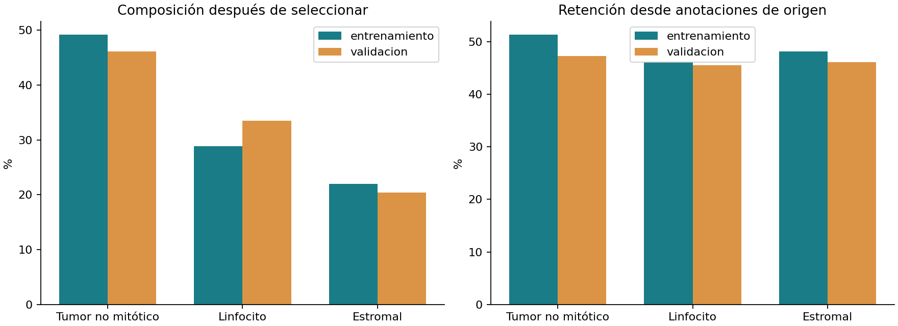
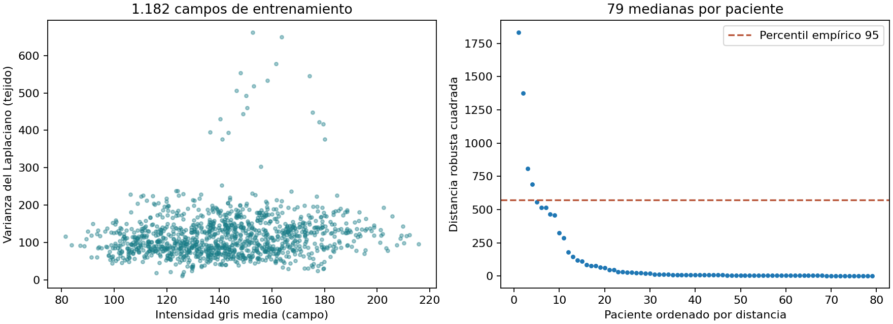

# Resultados del EDA y decisiones de preprocesamiento

## Procedencia y unidad de análisis
Se integran los archivos aportados por el autor: `CONTROL_PILOTO_QC_20261105_225210.zip`, `COMPARACION_RECORTES_QC.zip`, `EDA_BORDES_QC.zip` y la auditoría de calidad de originales. Son salidas reales de auditoría, no resultados predictivos. Los campos de entrenamiento analizados son **1.182**, de **79 pacientes**. Las mediciones de textura describen campos completos, no exclusivamente núcleos.

## Selección y balance
| Partición | Clase original | Origen | Incluidas | Retención | Proporción final |
|---|---|---:|---:|---:|---:|
| entrenamiento | tumor_nonMitotic | 13826 | 7089 | 51.27 % | 49.13 % |
| entrenamiento | lymphocyte | 9036 | 4162 | 46.06 % | 28.85 % |
| entrenamiento | nonTILnonMQ_stromal | 6607 | 3177 | 48.09 % | 22.02 % |
| validacion | tumor_nonMitotic | 3485 | 1646 | 47.23 % | 46.09 % |
| validacion | lymphocyte | 2629 | 1196 | 45.49 % | 33.49 % |
| validacion | nonTILnonMQ_stromal | 1582 | 729 | 46.08 % | 20.41 % |

**Resultado:** el piloto contiene 14.428 recortes de entrenamiento y 3.571 de validación. La clase mayoritaria no alcanza el 50 % en ninguna partición. La razón mayoritaria/minoritaria es 2.23 en entrenamiento y 2.26 en validación. La retención difiere entre clases, por lo que el conjunto de recortes no representa automáticamente la distribución original.

**Interpretación y decisión:** usar macro-F1 y métricas por clase. La selección sin padding resuelve el artefacto de borde, pero introduce sesgo hacia núcleos interiores. Deben reportarse los denominadores y tasas de exclusión, no únicamente el número final. No se modifica la pérdida del piloto ya en curso; cualquier ponderación futura debe calcularse en train y compararse bajo un protocolo nuevo.

## Geometría y alternativas de recorte
La comparación sobre 29.394 cajas válidas de entrenamiento encontró:

| Alternativa | Con relleno | Caja no contenida | Descentrado máximo (px) |
|---|---:|---:|---:|
| Centrada 128 | 14.961 (50.90 %) | 7 | 0,71 |
| Ventana 128 desplazada al interior | 0 | 7 | 77,79 |
| Centrada 96 | 10.966 (37.31 %) | 111 | 0,71 |

**Interpretación:** desplazar la ventana evita relleno pero puede alejar el objetivo del centro; reducirla a 96 no elimina el relleno y aumenta cajas no contenidas. El piloto conserva ventanas centradas de 128 que caben en la imagen. No confundir esa selección con desplazar todas las ventanas hacia el interior.

La auditoría geométrica original señaló 462 cajas parcialmente fuera de campo y 75 vacías/invertidas. Los percentiles se expresan en píxeles: una caja delimitadora no es el contorno nuclear ni permite calcular circularidad biológica. Los totales de ensayos anteriores no se mezclan: 14.961 corresponde específicamente a la comparación de alternativas sobre 29.394 cajas.

## Intensidad, contraste y textura
| Indicador de campo | P5 | Mediana | P95 |
|---|---:|---:|---:|
| gris_media | 103.309 | 142.104 | 185.163 |
| gris_sd | 31.899 | 43.444 | 62.072 |
| saturacion_media | 0.168 | 0.331 | 0.497 |
| laplaciano_var_tejido | 51.635 | 107.825 | 198.208 |
| fondo_claro_235 | 0.000 | 0.009 | 0.120 |
| entropia_gris | 6.896 | 7.352 | 7.699 |

**Interpretación:** existe heterogeneidad de intensidad, textura y fondo. La varianza del Laplaciano combina estructura y nitidez, por lo que un valor bajo no confirma desenfoque. El fondo claro se define mediante umbrales RGB y puede omitir espacios rosados. Estas métricas no justifican eliminar campos automáticamente.

**Decisión:** conservar los píxeles originales para la auditoría y evitar filtros de realce no evaluados. La división por 255 del piloto es reescalado fijo; aún se debe documentar media y desviación globales por canal en los recortes train si se adopta estandarización. Las medianas de medias por campo no sustituyen esos estadísticos de píxeles.

## Revisión multivariada nueva
Se agregaron por paciente las medianas de seis indicadores: gris medio, desviación de gris, saturación, Laplaciano en tejido, fondo claro 235 y entropía. Se transformó el Laplaciano con log(1+x), se centró por mediana y escaló por IQR. Se ajustó covarianza robusta Minimum Covariance Determinant con semilla 4101 y se calcularon distancias cuadradas.

**Resultado:** el percentil empírico 95 de las distancias es 571.393; **4 de 79 pacientes** quedan priorizados para inspección. El archivo `evidencias/calidad_multivariada_pacientes.csv` conserva el orden y sus indicadores.

**Interpretación:** el 5 % superior es un criterio exploratorio de priorización elegido para esta revisión, no una prevalencia estimada de mala calidad ni un umbral clínico. No se aplican p-valores o exclusiones. La inspección visual de esos pacientes sigue pendiente. La agregación por paciente reduce la dominancia de sujetos con más campos, aunque puede ocultar anomalías de campos individuales.

## Duplicados y límites
El control del piloto reporta cero grupos de duplicados exactos y cero duplicados exactos entre grupos. Esto no descarta casi duplicados, campos solapados ni atajos visuales. Las clases proceden de anotaciones publicadas y no se han revalidado individualmente.

Quedan pendientes: revisión visual de casos priorizados, casi duplicados perceptuales, calidad a nivel nuclear, acuerdo/ruido de etiquetas y desplazamiento train-validación con incertidumbre. No se han abierto imágenes de prueba o reserva para este análisis nuevo.

## Reproducibilidad
El script `scripts/consolidar_eda.py` reproduce las tablas y gráficas a partir de las evidencias incluidas. El registro `evidencias/procedencia.json` conserva hashes de los archivos fuente. Ninguna medición del EDA se presenta como desempeño del clasificador.
