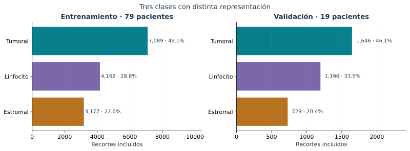
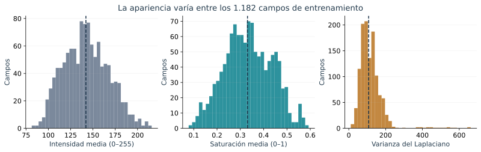

# EDA histórico de campos y recortes

Este capítulo conserva la auditoría del piloto anterior. Sus conteos y estadísticas no corresponden a V2. El [análisis vigente del conjunto de desarrollo](02_desarrollo_v2.md) reúne integridad, balance, histogramas, similitud, procedencia e incertidumbre de la nueva partición.

## Procedencia y unidad de análisis
Se integran los archivos aportados por el autor: `CONTROL_PILOTO_QC_20261105_225210.zip`, `COMPARACION_RECORTES_QC.zip`, `EDA_BORDES_QC.zip` y la auditoría de calidad de originales. Son salidas reales de auditoría, no resultados predictivos. Los campos de entrenamiento analizados son **1.182**, de **79 pacientes**. Las mediciones de textura describen campos completos, no exclusivamente núcleos.

## Selección y balance
| Partición | Clase original | Origen | Incluidas | Retención | Proporción final |
|---|---|---:|---:|---:|---:|
| entrenamiento | tumor_nonMitotic | 13826 | 7089 | 51.27 % | 49.13 % |
| entrenamiento | lymphocyte | 9036 | 4162 | 46.06 % | 28.85 % |
| entrenamiento | nonTILnonMQ_stromal | 6607 | 3177 | 48.09 % | 22.02 % |
| validacion | tumor_nonMitotic | 3485 | 1646 | 47.23 % | 46.09 % |
| validacion | lymphocyte | 2629 | 1196 | 45.49 % | 33.49 % |
| validacion | nonTILnonMQ_stromal | 1582 | 729 | 46.08 % | 20.41 % |

**Resultado:** el piloto contiene 14.428 recortes de entrenamiento y 3.571 de validación. La clase mayoritaria no alcanza el 50 % en ninguna partición. La razón mayoritaria/minoritaria es 2.23 en entrenamiento y 2.26 en validación. La retención difiere entre clases, por lo que el conjunto de recortes no representa automáticamente la distribución original.

**Interpretación y decisión:** se utiliza macro-F1 para asignar el mismo peso a cada clase en la evaluación, junto con métricas específicas por categoría. La selección sin relleno evita ese artefacto, pero introduce sesgo hacia núcleos interiores. La retención de núcleos tumorales en entrenamiento supera en 5,21 puntos porcentuales la de linfocitos. Por ello, el desempeño describe la población de recortes seleccionados y no la totalidad de las anotaciones originales. El entrenamiento empleó entropía cruzada sin ponderación; no se evaluó una variante con pesos de clase.

## Geometría y alternativas de recorte
La comparación sobre 29.394 cajas válidas de entrenamiento encontró:

| Alternativa | Con relleno | Caja no contenida | Descentrado máximo (px) |
|---|---:|---:|---:|
| Centrada 128 | 14.961 (50.90 %) | 7 | 0,71 |
| Ventana 128 desplazada al interior | 0 | 7 | 77,79 |
| Centrada 96 | 10.966 (37.31 %) | 111 | 0,71 |

**Interpretación:** desplazar la ventana evita relleno pero puede alejar el objetivo del centro; reducirla a 96 no elimina el relleno y aumenta cajas no contenidas. El piloto conserva ventanas centradas de 128 que caben en la imagen. Este procedimiento excluye ventanas no admisibles, en lugar de desplazar su centro.

La auditoría geométrica original señaló 462 cajas parcialmente fuera de campo y 75 vacías/invertidas. Los percentiles se expresan en píxeles: una caja delimitadora no es el contorno nuclear ni permite calcular circularidad biológica. Los totales de ensayos anteriores no se mezclan: 14.961 corresponde específicamente a la comparación de alternativas sobre 29.394 cajas.

## Intensidad, contraste y textura

| Indicador de campo | P5 | Mediana | P95 |
|---|---:|---:|---:|
| gris_media | 103.309 | 142.104 | 185.163 |
| gris_sd | 31.899 | 43.444 | 62.072 |
| saturacion_media | 0.168 | 0.331 | 0.497 |
| laplaciano_var_tejido | 51.635 | 107.825 | 198.208 |
| fondo_claro_235 | 0.000 | 0.009 | 0.120 |
| entropia_gris | 6.896 | 7.352 | 7.699 |

**Interpretación:** existe heterogeneidad de intensidad, textura y fondo. La varianza del Laplaciano combina estructura y nitidez, por lo que un valor bajo no confirma desenfoque. El fondo claro se define mediante umbrales RGB y puede omitir espacios rosados. Estas métricas no justifican eliminar campos automáticamente.

**Decisión:** conservar los píxeles originales para la auditoría y evitar filtros de realce no evaluados. La división por 255 del piloto es reescalado fijo; no se aplicó estandarización mediante medias y desviaciones por canal. Las medianas de medias por campo no sustituyen esos estadísticos de píxeles.

## Análisis multivariado de calidad
Se agregaron por paciente las medianas de seis indicadores: gris medio, desviación de gris, saturación, Laplaciano en tejido, fondo claro 235 y entropía. Se transformó el Laplaciano con log(1+x), se centró por mediana y escaló por IQR. Se ajustó covarianza robusta Minimum Covariance Determinant con semilla 4101 y se calcularon distancias cuadradas.

**Resultado:** el percentil empírico 95 de las distancias es 571.393; **4 de 79 pacientes** quedan priorizados para inspección. El archivo `evidencias/calidad_multivariada_pacientes.csv` conserva el orden y sus indicadores.

**Interpretación:** el 5 % superior es un criterio exploratorio de priorización elegido para esta revisión, no una prevalencia estimada de mala calidad ni un umbral clínico. No se aplican p-valores o exclusiones. Las distancias no se contrastaron con una adjudicación visual de calidad, por lo que no permiten clasificar esos pacientes como defectuosos. La agregación por paciente reduce la dominancia de sujetos con más campos, aunque puede ocultar anomalías de campos individuales.

## Duplicados y límites
El control del piloto reporta cero grupos de duplicados exactos y cero duplicados exactos entre grupos. Esto no descarta casi duplicados, campos solapados ni atajos visuales. Las clases proceden de anotaciones publicadas y no se han revalidado individualmente.

La auditoría se limita a igualdad exacta de archivos y mediciones de campos. No cuantifica similitud perceptual entre imágenes, concordancia entre anotadores ni desplazamiento de distribución entre particiones. En consecuencia, no permite descartar redundancia visual residual, errores de etiqueta o diferencias de dominio. Las imágenes de prueba y reserva no se utilizaron en este análisis.

## Reproducibilidad
El script `scripts/consolidar_eda.py` reproduce las tablas y gráficas a partir de las evidencias incluidas. El registro `evidencias/procedencia.json` conserva hashes de los archivos fuente. Ninguna medición del EDA se presenta como desempeño del clasificador.

## Balance informacional y estadísticos RGB

La entropía de las clases, $H=-\sum_k p_k\log_2p_k$, es **1,5018 bits** en entrenamiento y **1,5115 bits** en validación. Respecto al máximo $\log_2(3)$, corresponden al 94,75% y 95,37%. Existe desbalance, aunque ninguna clase concentra la mayor parte de la distribución. La similitud de estas entropías no demuestra igualdad de distribuciones de imagen ni ausencia de cambio de dominio.

Se reconstruyeron los momentos RGB de **161.115.264 píxeles** de los 1.182 campos de entrenamiento, ponderando cada campo por su número de píxeles. Para pesos $n_j$, medias $\mu_j$ y desviaciones poblacionales $s_j$, se utilizó $\mu=\sum n_j\mu_j/\sum n_j$ y $\sigma^2=\sum n_j(s_j^2+\mu_j^2)/\sum n_j-\mu^2$.

| Canal | Media (0–255) | DE (0–255) | Media (0–1) | DE (0–1) |
|---|---:|---:|---:|---:|
| Rojo | 169,99 | 51,55 | 0,6666 | 0,2021 |
| Verde | 123,65 | 56,17 | 0,4849 | 0,2203 |
| Azul | 164,05 | 43,21 | 0,6434 | 0,1695 |

El canal verde presenta menor media y mayor dispersión que los otros canales. Estos resultados describen los campos completos, incluido el fondo, y **no son los estadísticos de los recortes utilizados para entrenar**. No se emplearon para normalizar retrospectivamente el piloto. El cálculo se reproduce con `scripts/ampliar_eda.py`; las tablas están en `evidencias/rgb_campos_train.csv` y `entropia_clases.csv`.

## Consecuencias técnicas del EDA

| Análisis | Decisión de preprocesamiento aplicada | Impacto en la arquitectura | Riesgo identificado |
|---|---|---|---|
| Agrupación por paciente | Separación de pacientes entre entrenamiento y validación | La red recibe recortes; la evaluación conserva agrupación clínica | Recortes de un mismo paciente no son observaciones independientes |
| Balance y retención | Selección documentada; sin sobremuestreo ni ponderación de pérdida | Tres salidas y evaluación macro-F1, sin alterar el cabezal por prevalencia | La retención diferencial modifica la población de recortes |
| Geometría | Ventana centrada 128×128 sin relleno | Entrada fija; contexto alrededor del núcleo | Exclusión de bordes y presencia de núcleos vecinos |
| Intensidad y RGB | División fija por 255; sin realce ni normalización de tinción | Conservación de tres canales de color | Dependencia de apariencia de tinción; los momentos de campo no sustituyen los de recorte |
| Textura y contraste | Conservación de imágenes sin exclusión por estos indicadores | Convoluciones sobre textura original | Las métricas mezclan morfología y calidad; no diagnostican desenfoque |
| Distancias multivariadas | Sin exclusión automática de los cuatro pacientes señalados | Sin modificación de arquitectura o pérdida | Un valor extremo no acredita defecto; la agregación puede ocultar anomalías locales |
| Duplicados exactos | Verificación de identidad de archivos | Sin cambio de red | La igualdad de hash no detecta recortes visualmente similares |

Los estadísticos de intensidad proceden exclusivamente de entrenamiento. La inspección de proporciones de validación describe la partición ya utilizada y no se empleó para reajustar transformaciones o pérdidas.
