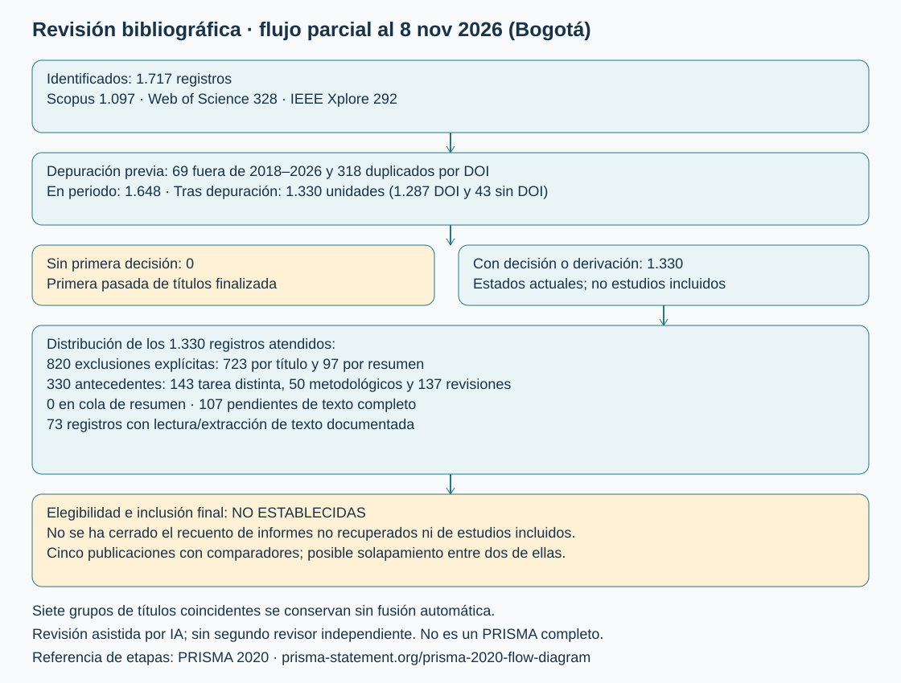

# Estado del arte: clasificación nuclear en histología

La clasificación nuclear requiere distinguir células con apariencia parcialmente semejante y variaciones de tinción, adquisición y contexto tisular. La literatura aborda el problema mediante representaciones locales, información del entorno y relaciones entre células. El interés de una arquitectura depende tanto de esa representación como de la calidad de las etiquetas y del protocolo de evaluación.

El proyecto NuCLS compara tres clasificadores de recortes RGB con contexto: una CNN compacta con BatchNorm, DenseNet121 y ResNet50. La revisión fundamenta esta comparación y examina las condiciones que permiten interpretar sus resultados. La unidad de predicción es el núcleo previamente localizado; los sistemas de segmentación, detección y diagnóstico de láminas se consideran antecedentes relacionados, con objetivos de evaluación diferentes.

## 1. Método de la revisión crítica

| Base | Exportación original | Publicación 2018–2026 |
|---|---:|---:|
| Scopus | 1.097 | 1.057 |
| Web of Science | 328 | 318 |
| IEEE Xplore | 292 | 273 |
| Total | 1.717 | 1.648 |

Se separaron 69 registros por año de publicación fuera de la ventana analítica. La normalización del DOI permitió agrupar 318 registros repetidos y producir 1.330 unidades para cribado: 1.287 con DOI distinto y 43 sin DOI. Siete grupos presentan títulos normalizados coincidentes; no se fusionaron automáticamente porque un título puede corresponder a versiones o documentos distintos. Estas cifras describen identificación y depuración, no inclusión de estudios ni un flujo PRISMA completo.

Se desarrolla una revisión crítica dirigida, apoyada en una búsqueda multibase y en la extracción verificable de estudios pertinentes. La síntesis no constituye una revisión sistemática exhaustiva: sus conclusiones se restringen a las fuentes examinadas. El inventario amplio permite conservar la trazabilidad de la recuperación, mientras que la discusión se organiza alrededor de comparaciones cuya tarea, entrada y métrica pueden identificarse.

La consulta comunicada para la búsqueda fue `(nucle* AND classif*) AND (histolog* OR histopatholog*) AND ("deep learning" OR "convolutional neural network" OR CNN OR transformer*)`, con adaptación por campo en cada plataforma. Las exportaciones permiten verificar registros y fechas de publicación, pero no reconstruyen por sí solas todos los filtros de la interfaz. El historial de consultas constituye una evidencia independiente.

La extracción distingue arquitectura exacta, función del modelo, representación de entrada, conjunto de datos, unidad de partición y métrica. La lectura de títulos y resúmenes identifica candidatos para texto completo; la prioridad automática no determina exclusión ni calidad. La revisión asistida por IA no representa dos revisores independientes.

La revisión se centra en modelos que asignan una categoría celular a un núcleo previamente localizado en una imagen histológica. Este alcance permite identificar referencias comparables con la tarea NuCLS y distinguirlas de sistemas cuyo resultado principal es detectar núcleos, delimitar sus contornos o diagnosticar una imagen completa.

| Criterio | Aplicación en la revisión |
|---|---|
| Pertinencia de la tarea | Priorizar clasificación de tipos nucleares a partir de imágenes histológicas; registrar por separado subclasificación binaria, mitosis e intensidad inmunohistoquímica |
| Función de la arquitectura | Identificar si actúa como clasificador independiente, extractor de características o componente de un sistema híbrido |
| Información de entrada | Documentar tejido, tinción, resolución, contexto, máscaras y otras entradas necesarias |
| Evidencia extraíble | Registrar arquitectura exacta, dataset, partición, métrica y valor; conservar como no reportado aquello que la fuente no permite verificar |
| Periodo de identificación | Aplicar la ventana 2018–2026 a las exportaciones; distinguir los antecedentes fundacionales anteriores utilizados para contextualizar el problema |
| Comparabilidad | Evitar ordenar conjuntamente resultados con distintas clases, métricas, tratamientos o unidades de partición |

Los estudios de tareas adyacentes pueden fundamentar el contexto metodológico, pero no se contabilizan automáticamente como usos de un clasificador nuclear independiente. La selección por pertinencia tampoco equivale a una evaluación de calidad: ambas decisiones se documentan por separado. Estos criterios organizan la lectura dirigida realizada; no se presentan como criterios prerregistrados antes de las búsquedas ni como evidencia de que todos los registros recuperados hayan sido evaluados.

### Trazabilidad de la selección

Se documentaron decisiones o derivaciones de lectura para 122 registros del inventario. Un lote previo comprende 80 títulos y 16 resúmenes; estos últimos se suman a las 24 lecturas adicionales de resúmenes previamente registradas. Una derivación a lectura de resumen o texto completo no equivale a inclusión definitiva. La selección dirigida identificó estudios de clasificación nuclear y separó tareas adyacentes: mitosis, intensidad inmunohistoquímica, graduación de atipia y diagnóstico de imágenes completas. Estas tareas aportan contexto, pero sus arquitecturas no se contabilizan como comparadores equivalentes de clasificación fenotípica en H&E. El inventario conserva 1.208 registros sin decisión; por ello, no se atribuye exhaustividad a la síntesis ni se estima una frecuencia poblacional de arquitecturas.

Una ampliación examinó 17 resúmenes y las secciones metodológicas y comparativas de SENUCLS. Se identificaron nueve candidatos a texto completo, siete antecedentes de tareas o clasificadores distintos y un estudio estructural revisado. El [registro consolidado](https://github.com/aduartech81/NuCLS_DeepLearning/blob/main/evidencias/literatura/cribado_consolidado.csv) reúne las decisiones sin modificar las exportaciones originales.

Las 80 decisiones de ese lote se conservan en [el registro adicional](https://github.com/aduartech81/NuCLS_DeepLearning/blob/main/evidencias/literatura/cribado_adicional_80.csv). Las decisiones previas y su fundamento se conservan en [el registro de lectura](https://github.com/aduartech81/NuCLS_DeepLearning/blob/main/evidencias/literatura/revision_adicional_24.csv). La evaluación de calidad distingue información ausente de un defecto demostrado; un resumen insuficiente no constituye evidencia de fuga de datos.

## 2. Etiquetas, contexto y definición del problema

Amgad et al. (2022) sitúan la generación de etiquetas en el centro del problema: NuCLS reúne anotaciones de estudiantes y patólogos sobre histología mamaria H&E de TCGA. El trabajo distingue anotaciones individuales y múltiples, e incorpora inferencia de etiquetas y evaluación de concordancia. Por tanto, una etiqueta disponible no equivale a una observación exenta de incertidumbre.

Para este proyecto, la consecuencia es metodológica: verificar archivos, dimensiones y valores faltantes acredita integridad técnica, pero no mide concordancia diagnóstica. La selección de tres categorías y de recortes interiores también delimita la población evaluada. Las métricas obtenidas deben interpretarse respecto a esas etiquetas y reglas de selección, sin extenderlas a todas las células presentes en una lámina.

Fuente: [Amgad et al., descripción de datos, concordancia y limitaciones](https://pmc.ncbi.nlm.nih.gov/articles/PMC9112766/).

La independencia de los recortes constituye otra condición central: muchos núcleos pueden proceder de un mismo paciente o campo histológico. Por ello, el número de imágenes no equivale al número de observaciones biológicas independientes. La comparación experimental utiliza agrupación por paciente y procedencia, y distingue variabilidad entre inicializaciones de variabilidad entre pacientes. Esta decisión responde al diseño de la evaluación; no elimina por sí sola los efectos de selección del conjunto de datos.

## 3. Evidencia cuantitativa de los modelos de referencia

El texto de autor de OLConvNet permite separar dos resultados: CNN con salida softmax y fusión de características profundas con descriptores manuales. La tabla 1 corresponde al primer caso.

| Referencia | Problema | Datos | Modelo básico | Métricas | Valores publicados |
|---|---|---|---|---|---|
| OLConvNet, tabla 1 | Clasificación nuclear, cuatro clases | Colon; recortes 27×27 | CNN3L | F1 / AUC multiclase | 0,8040 / 0,9441 |
| OLConvNet, tabla 1 | Igual | Igual | AlexNet | F1 / AUC multiclase | 0,8216 / 0,9386 |
| OLConvNet, tabla 1 | Igual | Igual | VGG16 | F1 / AUC multiclase | 0,8689 / 0,9757 |
| OLConvNet, tabla 1 | Igual | Igual | VGG19 | F1 / AUC multiclase | 0,8578 / 0,9701 |
| OLConvNet, tabla 1 | Igual | Igual | ResNet50 | F1 / AUC multiclase | 0,8892 / 0,9799 |
| OLConvNet, tabla 1 | Igual | Igual | InceptionV3 | F1 / AUC multiclase | 0,8175 / 0,9538 |
| OLConvNet, tabla 1 | Igual | Igual | DenseNet121 | F1 / AUC multiclase | 0,8706 / 0,9756 |

ResNet50 aislada obtiene F1 0,8892; el 0,9677 publicado para su variante híbrida incorpora otra representación y otro clasificador. Atribuir ambos resultados a la misma configuración confundiría el efecto de la arquitectura con el de la fusión.

La sección 4.1 describe generación sintética antes de una división 70/15/15. Ese orden introduce riesgo de dependencia entre subconjuntos; la descripción tampoco establece agrupación por paciente. No se traslada este procedimiento al experimento NuCLS. El artículo y su preprint se consideran una sola unidad bibliográfica.

Fuente: [texto de autor, sección 4.1 y tablas 1–4](https://arxiv.org/pdf/2202.10177); [DOI 10.1145/3345318](https://doi.org/10.1145/3345318).

### Capacidad y referencias compactas

Basha et al. compararon RCCNet con softmaxCNN_IN27, una variante softmaxCNN, AlexNet adaptada, CIFAR-VGG, GoogLeNet adaptada y WRN. RCCNet utiliza entradas RGB de 32×32, cuatro convoluciones de 32, 32, 64 y 64 filtros, dos reducciones espaciales y capas densas de 512, 512 y cuatro salidas. El entrenamiento incorpora BatchNorm y dropout.

En CRCHistoPhenotypes se informa una partición 80/20 de 22.444 recortes y un F1 ponderado de 0,7887. El texto no establece en esa descripción separación por paciente; tampoco presenta dispersión entre semillas en la tabla comparativa. Además, muestra curvas de exactitud de prueba durante el entrenamiento. Estos aspectos limitan la interpretación de generalización y requieren distinguir seguimiento de prueba de selección de modelos.

El estudio aporta una arquitectura verificable y comparadores concretos, pero su métrica, resolución, tejido y clases difieren del piloto NuCLS. Su presencia no prueba que RCCNet sea uno de los tres modelos más frecuentes.

Fuente: Basha et al., ICARCV 2018, [texto completo de autor, secciones II–IV](https://arxiv.org/html/1810.02797v3), [DOI](https://doi.org/10.1109/ICARCV.2018.8581147).

### Efecto del contexto

Sánchez-Torres et al. (2026) compararon ResNet50 y ViT en PanNuke con cinco clases. La tabla 6 distingue núcleos con contexto y núcleos aislados:

| Modelo y entrada | F1 neoplásico (%) | F1 conectivo (%) | F1 inflamatorio (%) | F1 epitelial (%) | F1 muerto (%) |
|---|---:|---:|---:|---:|---:|
| ResNet50 con contexto | 82,90 | 71,49 | 71,98 | 71,49 | 49,39 |
| ResNet50 sin contexto | 78,71 | 63,21 | 68,99 | 64,39 | 41,13 |
| ViT con contexto | 82,19 | 69,01 | 70,19 | 71,59 | 47,93 |

La tabla no presenta dispersión. La mejora conectiva de ResNet50 al conservar contexto es de 8,28 puntos; su extrapolación a NuCLS requiere cautela. Las clases, particiones y redes difieren. Además, la tabla 14 combina valores de distintos tratamientos: para núcleos muertos muestra 51,66%, asociado al sobremuestreo en la tabla 11, frente a 49,39% en la tabla 6. Se conserva una única configuración para esta extracción.

Fuente: [Sánchez-Torres et al., tablas 6, 11 y 14](https://doi.org/10.1155/acis/4540418).

### Supervisión y conectividad

#### Supervisión limitada y transferencia entre tejidos

Jacobs, Brostow, Freeman, Alexander y Panagiotaki (2017), en *Detecting and Classifying Nuclei on a Budget*, compararon una CNN supervisada, su ajuste por transferencia y una CNN Γ-ladder semisupervisada. La clasificación utiliza ventanas de 27×27 píxeles y tres categorías prostáticas. Se incluye como antecedente metodológico anterior al intervalo reciente de búsqueda.

| Proporción etiquetada | Macro-F1 CNN supervisada | Macro-F1 CNN ajustada | Macro-F1 Γ-ladder |
|---|---:|---:|---:|
| 1% | 0,639 ± 0,021 | 0,695 ± 0,061 | 0,738 ± 0,019 |
| 3% | 0,725 ± 0,012 | 0,752 ± 0,008 | 0,762 ± 0,010 |
| 5% | 0,761 ± 0,003 | 0,769 ± 0,007 | 0,765 ± 0,008 |
| 100% | 0,820 ± 0,005 | 0,819 ± 0,002 | 0,825 ± 0,004 |

La ventaja Γ-ladder frente a la CNN supervisada, con la misma proporción etiquetada, pasa de 9,9 puntos con 1% etiquetado a 0,5 puntos con todos los datos. La ventaja arquitectónica depende, por tanto, del régimen de supervisión. La dispersión publicada no debe confundirse con un intervalo de confianza. La CNN de este estudio no es idéntica a la CNN local implementada en NuCLS.

Fuente: [texto completo institucional, tabla 3](https://discovery.ucl.ac.uk/id/eprint/1573202/1/LABELS2017_7.pdf).

#### Conexiones densas y recurrencia convolucional

Alom, Asari, Parwani y Taha (2022) evaluaron clasificación, segmentación y detección en experimentos separados. Para clasificación de núcleos de colon compararon DenseNet y DCRN, con resultados F1 de **0,7941** y **0,8111**, respectivamente, en el apartado de análisis. La diferencia es de 1,70 puntos. El trabajo describe validación cruzada de cinco particiones.

Su comparación incluye la referencia softmax CNN con predictor de vecindad; no corresponde a una evaluación de MobileNetV2 como clasificador aislado. Los resultados de Dice de R2U-Net y F1 de detección de UD-Net pertenecen a otras tareas y se excluyen de la comparación de clasificación. Las cinco particiones no equivalen a cinco semillas y, sin equiparar agrupación y protocolo, la diferencia publicada no es directamente comparable con el piloto NuCLS.

Referencia: Alom, Z., Asari, V. K., Parwani, A. y Taha, T. M. (2022). *Microscopic nuclei classification, segmentation, and detection with improved deep convolutional neural networks (DCNN).* Diagnostic Pathology, 17, 38. [doi:10.1186/s13000-022-01189-5](https://doi.org/10.1186/s13000-022-01189-5).

### Referencias residuales y refinamiento espacial

Frei et al. (2026) evaluaron ResNet18 aislada en la ablación de GrEp, una propuesta de refinamiento mediante grafos. La comparación corresponde a células epiteliales normales y malignas.

| Referencia | Problema | Dataset de evaluación | Modelo de referencia | Métricas | Valores (%) |
|---|---|---|---|---|---|
| Frei et al., tabla 4 | Subclasificación epitelial binaria | TCGA | ResNet18 sin grafo ni filtro mediano | F epitelial / F maligno / F normal | 87,58 ± 0,97 / 90,83 ± 0,84 / 82,01 ± 1,22 |

La implementación parte de ImageNet, incorpora pooling adaptativo y salida binaria, y utiliza AdamW con tasa 10⁻⁶ durante 150 épocas. Este antecedente acredita el uso de ResNet18 como referencia de clasificación nuclear, además de su papel como extractor. Sin embargo, no reproduce el entrenamiento desde cero ni las tres categorías del piloto NuCLS. El valor del sistema completo con grafos no se atribuye a ResNet18 aislada.

Fuente: [Frei et al., texto completo de autor, sección 3.3 y tabla 4](https://aibex.ch/research/papers/Frei2025.pdf); [DOI](https://doi.org/10.1016/j.patcog.2025.112197).

## 4. Magnitud de las diferencias y calidad metodológica

Las diferencias siguientes se calculan dentro de una misma publicación y conservan su configuración de referencia. Se expresan en puntos porcentuales: para métricas en escala 0–1, Δ = 100 × (resultado del método − resultado del comparador). Describen diferencias observadas; no constituyen pruebas de significación ni estimaciones del efecto esperado en NuCLS.

| Comparación interna | Métrica y condición | Referencia | Alternativa | Δ (puntos) | Interpretación |
|---|---|---:|---:|---:|---|
| OLConvNet: ResNet50 aislada frente a su sistema híbrido | F1, cuatro clases | 0,8892 | 0,9677 | +7,85 | Cambian representación y clasificador; la diferencia no se atribuye solo a ResNet50 |
| PanNuke: ResNet50 sin y con contexto | F1 conectivo | 63,21% | 71,49% | +8,28 | El contexto modifica el desempeño de esta categoría bajo el protocolo publicado |
| Jacobs: CNN supervisada frente a Γ-ladder | Macro-F1, 1% etiquetado | 0,639 | 0,738 | +9,90 | Ventaja observada en un régimen de supervisión escasa |
| Jacobs: CNN supervisada frente a Γ-ladder | Macro-F1, 100% etiquetado | 0,820 | 0,825 | +0,50 | La ventaja se reduce al aumentar la supervisión |
| Alom: DenseNet frente a DCRN | F1 de clasificación | 0,7941 | 0,8111 | +1,70 | Diferencia bajo validación cruzada; no equivale a una comparación local por semillas |

La disminución de la diferencia en Jacobs muestra que una ventaja arquitectónica depende del régimen de datos. En OLConvNet, la mejora corresponde a un sistema híbrido completo. En PanNuke, la modificación de la entrada produce cambios por categoría. En conjunto, estos hallazgos justifican mantener constantes entrada, etiquetas y presupuesto de ajuste al comparar las redes del proyecto.

La evaluación se organiza por aspectos que afectan la comparabilidad; no se asigna una puntuación agregada que convierta información no reportada en un defecto demostrado.

| Estudio | Aporte verificable | Aspecto que limita la comparación | Consecuencia para NuCLS |
|---|---|---|---|
| Basha et al., RCCNet (2018) | CNN compacta y comparadores adaptados; arquitectura y conteo de parámetros descritos | F1 ponderado, cuatro clases y resolución distinta; agrupación por paciente no establecida en la descripción revisada | Declarar la adaptación a 128×128 y mantener separación por paciente; no comparar directamente el F1 publicado con macro-F1 |
| OLConvNet, DOI 10.1145/3345318 | Separa clasificadores CNN de sistemas híbridos con características manuales | Generación sintética descrita antes de la división; riesgo de dependencia entre particiones; agrupación por paciente no establecida | Evitar generación previa a la partición y atribuir a ResNet50 aislada únicamente su resultado de la tabla correspondiente |
| Sánchez-Torres et al. (2026) | Comparación de contexto frente a núcleo aislado con cinco categorías PanNuke | La tabla comparativa no informa dispersión; distintas tablas combinan tratamientos diferentes | Conservar una configuración por comparación y estudiar los recortes con contexto como una entrada definida, sin mezclar resultados |
| Frei et al., GrEp (2026) | Ablación que identifica ResNet18 sin refinamiento por grafo | Subclasificación epitelial binaria y transferencia desde ImageNet; tarea distinta de las tres categorías de NuCLS | Utilizarlo como evidencia de una referencia residual, sin trasladar su puntuación a clasificación multiclase desde cero |

Las referencias y las tablas de origen se identifican en las secciones anteriores. La incertidumbre por semillas, la separación por paciente y la unidad de cálculo del F1 no se consideran intercambiables entre publicaciones.

### Incertidumbre, reproducibilidad y costo

Jacobs presenta dispersión para sus condiciones de supervisión y GrEp la informa en la ablación residual. La tabla de contexto de PanNuke y la comparación extraída de RCCNet no ofrecen una dispersión equivalente. La ausencia de esa información en una tabla no demuestra que el artículo carezca de todo análisis de variabilidad. Tampoco permite reconstruir intervalos de confianza o pruebas pareadas a partir de medias aisladas.

Los tiempos publicados no se ordenan como si procedieran de un mismo equipo: dependen de hardware, resolución, lote, épocas e implementación. El número de parámetros describe almacenamiento y capacidad, pero no determina por sí solo latencia o memoria de activaciones. En el experimento NuCLS, costo y rendimiento deben medirse bajo condiciones comunes y atribuirse a la implementación exacta.

## 5. Desarrollo reciente del campo

La lectura adicional de resúmenes identifica una transición desde clasificadores de ventanas hacia sistemas que resuelven conjuntamente localización, segmentación y tipo nuclear. Esa evolución amplía las capacidades del sistema, pero también cambia el significado de sus métricas. Los siguientes registros se utilizan para orientar la recuperación de textos completos; sus cifras no se incorporan al ranking de clasificadores ni al conteo de arquitecturas verificadas.

| Línea | Estudios identificados en los resúmenes exportados | Implicación para el experimento |
|---|---|---|
| Textura y atención | TexSegNet, DOI 10.1109/EMBC58623.2025.11253497 | Distinguir desempeño conjunto de detección/clasificación del desempeño condicionado a conocer la ubicación del núcleo |
| Contexto, escala y orientación | MOSAIC, DOI 10.1016/j.cmpb.2026.109334; BDCNet, DOI 10.1016/j.eswa.2026.132123 | Las relaciones espaciales y la fusión multiescala requieren entradas y módulos diferentes de los tres clasificadores V2 |
| Generalización y categorías diversas | HistoPLUS, DOI 10.1016/j.jpi.2026.100696; KongNet, DOI 10.1016/j.media.2026.104233 | La evaluación externa y la cobertura de clases deben documentarse; no se infieren a partir de un F1 elevado |
| Balance y aprendizaje multitarea | AFINITI, DOI 10.1007/s00521-024-10114-4; aumento copy-paste, DOI 10.1007/s10278-024-01018-9 | La mejora de clases minoritarias depende del objetivo y del procedimiento; no justifica trasladar automáticamente una técnica al conjunto NuCLS |
| Clasificación con contexto y representación de láminas | HistoMSC, DOI 10.1016/j.compbiomed.2025.109991 | Separar la red de localización de los clasificadores de recortes antes de atribuir resultados a una arquitectura |

La evidencia de resumen permite reconocer líneas de investigación, pero no comprobar particiones, ablaciones ni todas las arquitecturas de comparación. La extracción de F1 por clase, Dice, AP o calidad panóptica exige conservar su definición: responden a objetivos distintos y no pueden ordenarse en una única escala de rendimiento.

Lou et al. (2024), en *Structure Embedded Nucleus Classification for Histopathology Images*, incorporan contornos y relaciones entre núcleos. Sus comparadores incluyen HoVer-Net y Mask2former. El artículo distingue evaluación con instancias predichas y con máscaras de referencia; por ello, su F-score no se equipara automáticamente al macro-F1 de recortes. Esta lectura confirma que la información de entrada debe formar parte de toda comparación de arquitecturas. [Texto de autor, secciones IV–V](https://guanbinli.com/papers/Structure_Embedded_Nucleus_Classification_for_Histopathology_Images.pdf), [DOI](https://doi.org/10.1109/TMI.2024.3388328).

Estas líneas amplían la representación disponible, pero no invalidan las referencias convolucionales. Un modelo que recibe máscaras, relaciones celulares o información multiescala responde a una pregunta distinta de un clasificador alimentado únicamente con un recorte RGB. Su comparación requiere una ablación que separe la contribución de la entrada, la arquitectura y el entrenamiento. Por ello, la complejidad de un sistema reciente no se interpreta como evidencia suficiente de superioridad para el problema delimitado.

## 6. Selección de arquitecturas y contribución del proyecto

La extracción estructurada cuenta una vez cada DOI por arquitectura y separa variantes adaptadas de versiones estándar. En cuatro textos con comparaciones verificadas, ResNet50 aparece en dos estudios; las restantes arquitecturas identificadas aparecen en uno. Estas frecuencias describen el subconjunto extraído y no todo el corpus recuperado. La [tabla completa de comparadores](https://github.com/aduartech81/NuCLS_DeepLearning/blob/main/evidencias/literatura/comparadores_texto_completo.csv) conserva problema, conjunto, modelo, métricas y valores por fuente.

| Selección v2 | Estudios verificados | Parámetros, tres clases | Rasgo estructural |
|---|---:|---:|---|
| softmaxCNN con BatchNorm, adaptada | 1 | 898.687 | Convoluciones secuenciales y clasificador pequeño |
| DenseNet121 | 1 | 6.956.931 | Concatenación densa de representaciones |
| ResNet50 | 2 | 23.514.179 | Conexiones residuales bottleneck |

La selección responde a tres funciones experimentales complementarias. La CNN compacta establece el desempeño alcanzable con menor capacidad; DenseNet121 permite evaluar reutilización de características mediante concatenaciones; ResNet50 incorpora aprendizaje residual y presenta la mayor recurrencia exacta en el subconjunto comparativo extraído. El objetivo es contrastar estas referencias bajo la misma entrada y partición, no identificar retrospectivamente una arquitectura ganadora a partir de puntuaciones de datasets diferentes.

| Referencia | Fundamento de elección | Pregunta que aporta a la comparación | Límite de la justificación |
|---|---|---|---|
| CNN compacta con BatchNorm | Comparador documentado en RCCNet y menor número de parámetros entre las tres implementaciones | ¿Qué rendimiento se obtiene con una representación convolucional secuencial de capacidad reducida? | La adaptación espacial a 128×128 impide tratarla como reproducción exacta del estudio de origen |
| DenseNet121 | Clasificador aislado cuantificado en OLConvNet; reutilización de características y capacidad intermedia | ¿La conectividad densa mejora el compromiso entre desempeño y número de parámetros? | Menos parámetros que ResNet50 no implica menor latencia ni menor memoria de activaciones |
| ResNet50 | Comparador multiclase identificado en OLConvNet y PanNuke; conexiones residuales | ¿La mayor capacidad residual aporta una ganancia reproducible frente a las otras referencias? | Su recurrencia en dos textos no demuestra predominio en el corpus completo |

Esta es una selección multicriterio sustentada en evidencia extraída. El criterio de la guía referido a las tres arquitecturas más frecuentes y sencillas no queda demostrado para el corpus completo: la recurrencia disponible se limita a cuatro textos comparativos y la sencillez admite indicadores diferentes. Se informa esta restricción para distinguir la pertinencia científica de las referencias del cumplimiento literal de ese criterio. No se modifica la selección a partir de resultados de entrenamiento observados.

La CNN pequeña reproduce el conteo publicado de 899.200 parámetros para cuatro clases y entrada 27×27. Para utilizar las ventanas comunes de 128×128 se reduce el mapa de 30×30 a una cuadrícula de 5×5 mediante promedios en bloques disjuntos de 6×6, equivalentes al pooling adaptativo de esas dimensiones. Se conservan las dimensiones del clasificador sin añadir parámetros. Esa adaptación modifica la agregación espacial y se declara explícitamente; no constituye reproducción exacta del experimento original. La verificación técnica inicial incluyó propagación y gradientes con tensores sintéticos; esa prueba comprueba ejecutabilidad y no estima capacidad predictiva.

El protocolo contempla inicialización desde cero y condiciones comunes, a diferencia de algunos estudios que emplean transferencia. Las redes establecen referencias experimentales con mecanismos de conectividad distintos, sin asumir igualdad de capacidad.

La selección y sus adaptaciones se describen en [el protocolo v2](https://github.com/aduartech81/NuCLS_DeepLearning/blob/main/protocolo/seleccion_modelos_v2.md). El [flujo experimental](https://github.com/aduartech81/NuCLS_DeepLearning/blob/main/protocolo/ejecucion_integrada_v2.md) separa búsqueda, piloto, planificación de corridas, evaluación final y reserva. Los resultados de CNN local, ResNet18 y MobileNetV2 siguen correspondiendo al piloto anterior.

### Brecha experimental

Los clasificadores convolucionales constituyen referencias pertinentes porque aprenden características locales directamente de los píxeles. Sin embargo, la evidencia revisada no sostiene una arquitectura universalmente superior. Las puntuaciones dependen del tejido, de las categorías, del contexto incluido, del preentrenamiento y de la forma de dividir los datos. El resultado de un sistema híbrido tampoco equivale al de su red extractora utilizada aisladamente.

La comparación de PanNuke muestra que retirar contexto puede disminuir el F1 de determinadas categorías; esto justifica declarar con precisión qué información contiene cada ventana. No permite afirmar que todo contexto sea beneficioso: el fondo y las características de adquisición también pueden introducir señales de procedencia. El diagnóstico de desplazamiento de NuCLS indica que las particiones son parcialmente distinguibles mediante descriptores sencillos, lo que refuerza la necesidad de separación por paciente y TSS y de una interpretación prudente de la generalización.

La brecha que aborda este entregable es una comparación controlada de tres referencias sobre la misma selección de recortes NuCLS, con preprocesamiento ajustado en entrenamiento, esfuerzo de búsqueda común y variabilidad entre ejecuciones. Se trata de una contribución experimental dentro del proyecto académico, no de una afirmación de novedad mundial ni de una arquitectura original. El baseline resultante deberá expresarse con su incertidumbre y su alcance poblacional.

La pregunta resultante es si, bajo una misma partición y tratamiento de imágenes, la conectividad densa o residual ofrece una mejora reproducible frente a una referencia compacta y qué costo implica. La literatura aporta antecedentes para formular la pregunta; la respuesta corresponde al experimento local. No se presupone que la red de mayor tamaño deba ganar.

### Conclusión

La evidencia examinada converge en una condición metodológica: la comparación de clasificadores nucleares exige controlar simultáneamente la representación de entrada, las etiquetas y la partición. Las diferencias observadas dentro de cada publicación muestran que el contexto, el régimen de supervisión y la combinación de descriptores pueden modificar el rendimiento tanto como el cambio de arquitectura. Por ello, los valores publicados sirven para fundamentar decisiones experimentales, no para anticipar el resultado en NuCLS.

El estudio adopta tres referencias verificables de capacidad y conectividad distintas y las compara sobre los mismos recortes. El EDA aporta la caracterización de balance, integridad y heterogeneidad de procedencia necesaria para interpretar esa comparación. La evaluación deberá establecer si una diferencia de desempeño se acompaña de estabilidad entre ejecuciones y de un costo computacional justificable; ninguna de estas propiedades se presupone por la profundidad de la red.

La revisión crítica queda delimitada a las fuentes y comparaciones documentadas. Su contribución es una síntesis metodológica aplicable al experimento; no acredita exhaustividad bibliográfica ni identifica los tres modelos dominantes de toda la literatura. Esta distinción preserva la trazabilidad entre lo que las fuentes permiten afirmar y lo que el experimento debe responder.

## 7. Fuentes principales y evidencia reproducible

Las referencias se vinculan a su DOI o al texto de autor utilizado. Los antecedentes de 2016 y 2017 se conservan como fundamentos históricos externos a la ventana reciente. El artículo OLConvNet y su preprint constituyen una sola unidad de estudio. No se asignan cuartiles bibliométricos sin verificar la revista, categoría y año correspondientes.

1. Sirinukunwattana et al. (2016). *Locality Sensitive Deep Learning for Detection and Classification of Nuclei in Routine Colon Cancer Histology Images*. [DOI](https://doi.org/10.1109/TMI.2016.2525803). Antecedente de detección y clasificación; consulta de resumen.
2. Jacobs et al. (2017). *Detecting and Classifying Nuclei on a Budget*. [Texto institucional](https://discovery.ucl.ac.uk/id/eprint/1573202/1/LABELS2017_7.pdf). Evidencia de supervisión limitada, tabla 3.
3. Basha et al. (2018). *RCCNet: An Efficient Convolutional Neural Network for Histological Routine Colon Cancer Nuclei Classification*. [DOI](https://doi.org/10.1109/ICARCV.2018.8581147). [Texto de autor](https://arxiv.org/html/1810.02797v3).
4. Tripathi y Singh (2020). *Cell nuclei classification in histopathological images using hybrid OLConvNet*. [DOI](https://doi.org/10.1145/3345318). [Preprint de 2022](https://arxiv.org/abs/2202.10177).
5. Alom et al. (2022). *Microscopic nuclei classification, segmentation, and detection with improved deep convolutional neural networks (DCNN)*. Diagnostic Pathology, 17, 38. [DOI](https://doi.org/10.1186/s13000-022-01189-5).
6. Amgad et al. (2022). *NuCLS: A scalable crowdsourcing approach and dataset for nucleus classification and segmentation in breast cancer*. GigaScience, 11, giac037. [DOI](https://doi.org/10.1093/gigascience/giac037).
7. Sánchez-Torres et al. (2026). Estudio comparativo de clasificación nuclear en PanNuke; tablas 6, 11 y 14. [Identificador del artículo](https://doi.org/10.1155/acis/4540418).
8. Frei et al. (2026). GrEp; Pattern Recognition, 171, 112197; sección 3.3 y tabla 4. [DOI](https://doi.org/10.1016/j.patcog.2025.112197). [Texto de autor](https://aibex.ch/research/papers/Frei2025.pdf).

El [inventario y las extracciones](https://github.com/aduartech81/NuCLS_DeepLearning/tree/main/evidencias/literatura) conservan la procedencia y el nivel de lectura. La [tabla de frecuencia](https://github.com/aduartech81/NuCLS_DeepLearning/blob/main/evidencias/literatura/frecuencia_comparadores_verificados.csv) contabiliza estudios únicos por arquitectura. Los registros no evaluados permanecen identificados como tales; no se transforman en exclusiones para cerrar artificialmente el flujo de selección.
