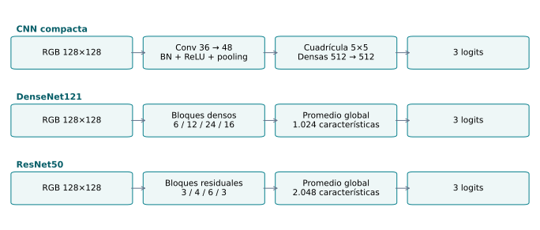

# Metodología del experimento v2

## Objetivo y unidad de análisis

El experimento compara tres redes para clasificar recortes nucleares en las categorías tumoral no mitótica, linfocitaria y estromal. La localización del núcleo procede de las anotaciones; la tarea evalúa clasificación de ventanas previamente seleccionadas. Cada recorte conserva el identificador de paciente y el código TSS para examinar dependencia y procedencia.

La partición comprende 83 pacientes de entrenamiento, 21 de validación y seis de reserva, con códigos TSS disjuntos. El conjunto histórico de prueba ya fue examinado y no se reutiliza como reserva independiente. La nueva reserva se define respecto a los registros de exposición auditados; esa comprobación no demuestra ausencia de cualquier acceso anterior no registrado.

## Arquitecturas y condiciones comunes

| Arquitectura | Parámetros entrenables | Organización característica |
|---|---:|---|
| softmaxCNN-BN adaptada | 898.687 | Convoluciones secuenciales y capas densas |
| DenseNet121 | 6.956.931 | Concatenación de representaciones entre capas |
| ResNet50 | 23.514.179 | Bloques bottleneck con conexiones residuales |

Los modelos se inicializan sin pesos preentrenados. La selección se fundamenta en los comparadores exactos extraídos de los textos revisados, con el alcance documental descrito en el estado del arte; no representa un ranking exhaustivo de toda la literatura. La adaptación de softmaxCNN conserva una cuadrícula de 5×5 antes de las capas densas. Para entradas de 128×128, el mapa previo de 30×30 se agrupa mediante bloques disjuntos de 6×6. Esta operación equivale al promedio adaptativo correspondiente y permite mantener el modo determinista de CUDA. La adaptación no añade parámetros y no constituye una reproducción idéntica del experimento publicado a otra resolución.

## Representación y complejidad de las referencias

### CNN compacta con BatchNorm

La implementación contiene dos convoluciones de 36 y 48 canales, con kernels 4×4 y 3×3, ReLU, BatchNorm y reducción máxima 2×2. La cuadrícula de 5×5 alimenta dos capas densas de 512 unidades, normalización por lotes y dropout de 0,5. La salida tiene tres unidades. El sesgo inductivo es local: los mismos filtros recorren la imagen; la agregación espacial y las capas densas integran el contexto del recorte. Su menor capacidad ofrece una referencia de costo moderado, aunque el aplanamiento conserva dependencia de la organización espacial y las capas densas concentran parámetros. La fuente comparativa es la softmaxCNN-IN27 con BN documentada en [RCCNet](https://doi.org/10.1109/ICARCV.2018.8581147); su F1 ponderado publicado es 0,7124, sin dispersión en la tabla extraída.

### DenseNet121

Los cuatro bloques densos contienen 6, 12, 24 y 16 capas compuestas, con crecimiento de 32 canales y transiciones entre bloques. Cada capa recibe la concatenación de las representaciones anteriores:

$$x_l=H_l([x_0,x_1,\ldots,x_{l-1}]).$$

La conectividad facilita reutilizar características y propagar gradientes. El promedio global produce 1.024 características para la salida lineal de tres clases. El menor número de parámetros respecto a ResNet50 no garantiza menor memoria de activaciones: las concatenaciones conservan numerosas representaciones. En [OLConvNet](https://doi.org/10.1145/3345318), la referencia DenseNet121 aislada obtiene F1 0,8706 y AUC 0,9756; estas cifras corresponden a colon y a su protocolo, no a NuCLS.

### ResNet50

Sus cuatro etapas contienen 3, 4, 6 y 3 bloques bottleneck. La transformación residual combina convoluciones 1×1, 3×3 y 1×1 con una ruta de identidad o proyección:

$$x_{l+1}=\operatorname{ReLU}(F_l(x_l)+S_l(x_l)).$$

La suma facilita aprender modificaciones de una representación previa. El promedio global entrega 2.048 características al clasificador de tres salidas. La red incorpora más parámetros que las otras dos referencias; esa capacidad puede mejorar la representación o aumentar el riesgo de sobreajuste según los datos. Su respaldo incluye [OLConvNet](https://doi.org/10.1145/3345318), F1 0,8892 y AUC 0,9799, y la comparación con contexto de [PanNuke](https://doi.org/10.1155/acis/4540418). No se presupone que mayor profundidad produzca mayor generalización.

### Parámetros, operaciones y objetivo

Para una convolución con sesgo, $P_{conv}=(k_hk_wC_{in}+1)C_{out}$; para una capa densa, $P_{dense}=(d_{in}+1)d_{out}$. BatchNorm con parámetros afines aporta $2C$ parámetros entrenables; sus estadísticas móviles no se cuentan como tales. Las convoluciones configuradas sin sesgo omiten el término correspondiente. La suma de las capas produce los conteos de la tabla anterior. En la CNN compacta:

$$P=1764+72+15600+96+614912+1024+262656+1024+1539=898687.$$

El costo dominante de una convolución es $O(BH_oW_ok_hk_wC_{in}C_{out})$, y el de una capa densa $O(Bd_{in}d_{out})$. El costo de una red suma sus capas; la retropropagación conserva el mismo orden y añade operaciones y almacenamiento de activaciones. Los tiempos reales dependen del dispositivo y se obtienen de la ejecución, no de esta expresión analítica.

Las tres redes optimizan la entropía cruzada multiclase, $L=-B^{-1}\sum_i\log p_{i,y_i}$, con $p_{i,k}=\exp(z_{i,k})/\sum_j\exp(z_{i,j})$. En el código se entregan logits a la pérdida; no se aplica softmax dos veces. El uso de AdamW y el presupuesto común se detallan a continuación. Es una adaptación experimental compartida, no una reproducción de todos los hiperparámetros de cada artículo.

Estas referencias cumplen el propósito comparativo que desempeña un modelo logístico: establecer un punto de partida cuantificable bajo un protocolo común. La equivalencia es de función, no de capacidad ni de supuestos; las CNN aprenden representaciones no lineales y aprovechan estructura espacial. El alcance de su selección bibliográfica se conserva en el capítulo de literatura.

## Preprocesamiento y entrenamiento

Las intensidades se dividen por 255 y se estandarizan por canal con parámetros calculados exclusivamente en entrenamiento. Las rotaciones en múltiplos de 90° y la reflexión horizontal se aplican únicamente durante el entrenamiento. No se aplica normalización de tinción, CLAHE ni sobremuestreo previo a la partición. La validación y la reserva conservan su distribución observada.

Se utiliza entropía cruzada sin ponderación, lotes de 32 y limitación de la norma del gradiente a cinco. AdamW evalúa cuatro combinaciones por arquitectura: tasas de aprendizaje 0,0001 y 0,001, con penalización de pesos 0 o 0,0001. Cada ajuste dispone de hasta 25 épocas, un mínimo de cinco y paciencia de cinco. El checkpoint corresponde al mayor macro-F1 de validación; un empate conserva la primera época. La igualdad del presupuesto se refiere a configuraciones y épocas máximas, no a tiempo ni operaciones de cómputo.

## Selección y planificación de corridas

La búsqueda utiliza la semilla 4001. Los hiperparámetros se fijan por arquitectura mediante macro-F1 de validación; los empates favorecen menor tasa de aprendizaje y después menor penalización. Cinco semillas nuevas, 5101–5105, estiman la variabilidad de las diferencias pareadas. El número de corridas finales se planifica para una diferencia de 0,02 en macro-F1, potencia de 0,80 y nivel 0,05/3 para las tres parejas. Se adopta el mayor tamaño requerido, con mínimo cinco; si supera 50 por arquitectura, el flujo registra el límite y se detiene sin evaluar la reserva.

Las corridas finales comienzan en la semilla 6101. La referencia se selecciona por macro-F1 medio de validación, resolviendo empates por menor número de parámetros. El número de semillas describe estabilidad de optimización: aumentar semillas no aumenta el número de pacientes ni sustituye validación externa.

## Evaluación y reproducibilidad

Los identificadores y huellas de todos los checkpoints finales se fijan antes de evaluar la reserva. Cada checkpoint se evalúa una vez dentro del lote previsto. Las predicciones de reserva no intervienen en cambios de arquitectura, hiperparámetros o selección de épocas. Se conservan versiones, configuración, curvas y predicciones por paciente. La latencia se registra con calentamiento y sincronización de GPU; el tiempo por recorte dentro de un lote no equivale a latencia individual de una aplicación.

Las métricas del piloto histórico se presentan en su propio capítulo. La ejecución v2 aporta una evidencia diferente y sus resultados no se infieren a partir de aquel piloto.

## Alcance de la comparación posterior

La comparación de un modelo propuesto con las referencias corresponde al Entregable 3. Antes de observar sus resultados deberán fijarse la modificación propuesta, las hipótesis y la población sobre la cual se busca generalizar. El efecto principal será la diferencia de macro-F1 sobre los mismos casos, acompañada por incertidumbre, métricas por clase y análisis de errores. Una mejora de dos puntos se utiliza como objetivo operativo de planificación; no se interpreta como umbral clínico validado.

La independencia no se demuestra mediante una única métrica. Se documentan solapamientos de pacientes y TSS, duplicados y similitud perceptual; para la incertidumbre se conservan juntos los recortes de cada paciente. Con seis pacientes de reserva, la evidencia entre pacientes es limitada incluso si existen numerosas imágenes o semillas. La ausencia de significación no demuestra equivalencia, y una diferencia estadísticamente detectable no basta por sí sola para afirmar utilidad práctica.

## Enmienda para la entrega del 8 de noviembre

El plan original determinó 22 semillas por modelo. Antes de evaluar la reserva se autorizó un cierre intermedio con las primeras 11 semillas consecutivas (6101–6111) por restricción de tiempo. Se fijaron sus 33 checkpoints y la selección por validación en una carpeta de cierre separada; el plan y los pesos originales se conservaron. Esta enmienda no declara satisfecha la potencia original. La reserva ya ha sido evaluada para ese lote: las corridas posteriores deberán mantener la configuración congelada.
