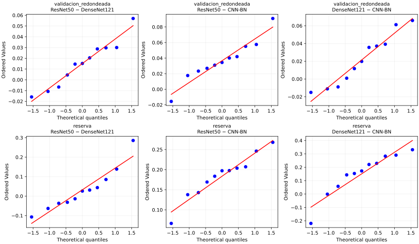

# Comparación estadística V2: resultados y alcance

<!-- PRESENTACION_CAPITULO -->

04 / INCERTIDUMBRE

Distinguir inicializaciones de unidades biológicas

33 corridas6 pacientes de reservaAnálisis agrupado exploratorio

<b>Los recortes no son pacientes independientes.</b> La variación entre semillas y la incertidumbre entre pacientes responden a preguntas distintas. Los intervalos de reserva se condicionan a los ajustes disponibles.

<!-- FIN_PRESENTACION_CAPITULO -->

## Diseño, procedencia y límites

El cierre contiene 11 semillas emparejadas (6101–6111) por arquitectura, sobre la misma partición. ResNet50 se eligió por el mayor macro-F1 medio de validación **antes de abrir la reserva**. Los análisis que siguen se calcularon después del cierre: son exploratorios, condicionados a esa partición y no seleccionan un nuevo baseline ni ajustan modelos.

La validación por semilla se reconstruyó del máximo macro-F1 impreso en el notebook ejecutado, redondeado a cuatro decimales. Sus medias coinciden con el resumen original dentro de 0,00005. Las pruebas de validación tienen esa precisión limitada; no sustituyen los JSON originales. La reserva utiliza las métricas por semilla ya guardadas. No se volvió a ejecutar inferencia.

Las semillas cuantifican variación del entrenamiento, no replicación de pacientes. Compartir el identificador de semilla define el emparejamiento operativo; no implica trayectorias aleatorias idénticas entre arquitecturas. La selección por validación condiciona su inferencia. Ningún resultado constituye confirmación externa.

## Contrastes pareados, efectos y normalidad

Se presentan conjuntamente t pareado y Wilcoxon bilateral; Holm corrige tres pares por conjunto y métrica, separadamente para cada prueba. No se elige la prueba que dé el menor p. Macro-F1 es primaria; AUC es secundaria exploratoria y su familia no controla conjuntamente todos los análisis de este capítulo. Cohen dz es media/DE de diferencias; el efecto biserial usa los rangos con signo. Los IC t del CSV son nominales del 95%, no simultáneos.

### Validación (valores redondeados)

| Contraste | Δ | p t Holm | p W Holm | dz | r biserial | p Shapiro |
|---|---|---|---|---|---|---|
| ResNet50 − DenseNet121 | 0.0152 | 0.06341 | 0.08398 | 0.705 | 0.667 | 0.7087 |
| ResNet50 − CNN-BN | 0.0366 | 0.003222 | 0.005859 | 1.369 | 0.970 | 0.751 |
| DenseNet121 − CNN-BN | 0.0215 | 0.06341 | 0.08398 | 0.752 | 0.697 | 0.4066 |

### Reserva: macro-F1

| Contraste | Δ | p t Holm | p W Holm | dz | r biserial | p Shapiro |
|---|---|---|---|---|---|---|
| ResNet50 − DenseNet121 | 0.0325 | 0.3439 | 0.5771 | 0.300 | 0.212 | 0.2689 |
| ResNet50 − CNN-BN | 0.1836 | 1.81e-06 | 0.00293 | 3.348 | 1.000 | 0.6753 |
| DenseNet121 − CNN-BN | 0.1510 | 0.02 | 0.03711 | 0.956 | 0.788 | 0.1606 |

### Reserva: AUC macro OvR

| Contraste | Δ | p t Holm | p W Holm | dz | r biserial | p Shapiro |
|---|---|---|---|---|---|---|
| ResNet50 − DenseNet121 | 0.0393 | 0.1877 | 0.04883 | 0.558 | 0.758 | 0.0007959 |
| ResNet50 − CNN-BN | 0.0748 | 0.01585 | 0.00293 | 1.070 | 1.000 | 0.1048 |
| DenseNet121 − CNN-BN | 0.0355 | 0.2947 | 0.08301 | 0.333 | 0.606 | 0.1091 |

Shapiro no rechaza normalidad en las seis diferencias de macro-F1, pero con n = 11 no la demuestra. En AUC ResNet50 − DenseNet121 sí la rechaza (p = 0,00080): t y Wilcoxon producen conclusiones distintas y ambas quedan visibles. Los Q-Q complementan el diagnóstico.

## Friedman y Nemenyi

Friedman usa semillas como bloques y rangos por bloque (1 = mejor). Con solo tres arquitecturas se calcula además la distribución nula exacta sobre las 6^11 permutaciones de rangos, mediante acumulación de estados; no hay empates. Nemenyi se presenta con aproximación de rango studentizado y su ajuste inherente para los tres pares. Su p no se vuelve a corregir con Holm.

| Conjunto | Q Friedman | p exacto | W Kendall |
|---|---|---|---|
| validacion_redondeada | 8.909 | 0.011181 | 0.405 |
| reserva | 11.455 | 0.0020417 | 0.521 |
| AUC_reserva | 13.273 | 0.00064638 | 0.603 |

| Conjunto | Par | p Nemenyi aproximado |
|---|---|---|
| validacion_redondeada | ResNet50 − DenseNet121 | 0.2945 |
| validacion_redondeada | ResNet50 − CNN-BN | 0.007987 |
| validacion_redondeada | DenseNet121 − CNN-BN | 0.2945 |
| reserva | ResNet50 − DenseNet121 | 0.7982 |
| reserva | ResNet50 − CNN-BN | 0.003955 |
| reserva | DenseNet121 − CNN-BN | 0.02835 |
| AUC_reserva | ResNet50 − DenseNet121 | 0.2945 |
| AUC_reserva | ResNet50 − CNN-BN | 0.0008457 |
| AUC_reserva | DenseNet121 − CNN-BN | 0.08346 |

## Dos fuentes de incertidumbre, sin selección del resultado favorable

ResNet50 − DenseNet121 en reserva es **+0,0325 macro-F1**. Entre semillas: p t = 0,3439, p Wilcoxon = 0,5771 e IC t nominal [−0,0404; 0,1055]. No se demuestra superioridad entre inicializaciones. DenseNet121 tiene DE 0,1112, frente a 0,0518 de ResNet50.

El bootstrap ya publicado, agrupado por los seis pacientes y condicionado a los ajustes disponibles, da IC nominal [0,0015; 0,0618]. Apenas excluye cero y no corrige todas las comparaciones. Cambia la fuente de variación: pacientes frente a entrenamiento. Ambos resultados deben leerse juntos; ninguno elimina la dependencia del sitio ni la incertidumbre de solo seis pacientes.

## Mejora mínima detectable y relevancia

Se conservan δ = 0,02, potencia 0,80 y α bilateral = 0,05/3 del plan de desarrollo. La DE de diferencias procede únicamente del piloto 5101–5105. Se invierte la potencia del t no central con 10 grados de libertad (integración equivalente sobre χ² y normal), sin estimar potencia a partir de la reserva.

| Variabilidad de referencia | DE piloto | MDE con 11 | Potencia para δ=0,02 |
|---|---|---|---|
| CNN-BN − DenseNet121 | 0.01720 | 0.01967 | 0.815 |
| CNN-BN − ResNet50 | 0.02663 | 0.03046 | 0.399 |
| DenseNet121 − ResNet50 | 0.01812 | 0.02073 | 0.767 |

**Para planificar un modelo avanzado, una mejora frente a ResNet50 de aproximadamente 0,0305 macro-F1 (3,05 puntos porcentuales) es detectable con 80% de potencia y 11 semillas bajo la mayor DE del piloto; además debe superar δ = 0,02 para ser relevante según el criterio operativo.** Es una referencia de planificación, no una garantía de significación ni un umbral clínico: el nuevo modelo puede tener otra DE y debe replanificarse con datos de desarrollo. Con la DE DenseNet121–ResNet50 la MDE es 0,0207.

Cerrar en 11 de las 22 semillas previstas deja una potencia de aproximadamente 0,399 para δ = 0,02 en el escenario más variable. La enmienda previa a la reserva protege la trazabilidad, pero no recupera la potencia: es una amenaza a la validez interna y un incumplimiento del tamaño originalmente requerido, que se declara explícitamente.

## McNemar, AUC y agrupación biológica

Se calcularon 33 pruebas exactas de McNemar (tres pares × once semillas), con Holm sobre las 33. Son **diagnósticas por recorte**: su supuesto de unidades independientes falla dentro de paciente. No se usan para afirmar superioridad clínica, ni se agrupan 11 × 969 observaciones como independientes.

Como sensibilidad se intercambian las predicciones completas de los modelos dentro de cada paciente, conjuntamente para todas las semillas: 64 permutaciones exactas. Se comparan accuracy y AUC macro OvR media entre semillas con Holm por tres pares y métrica. La prueba requiere intercambiabilidad de modelos por paciente, es exploratoria y tiene resolución muy limitada (mínimo bilateral 0,03125); seis pacientes tampoco representan sitios independientes. La AUC agrupada se recalcula directamente de los CSV, normalizando únicamente el redondeo de la suma de probabilidades para mantener el criterio del análisis original. No se aplica DeLong ingenuamente a recortes dependientes.

| Par | Δ AUC | p AUC Holm | Δ accuracy | p accuracy Holm |
|---|---|---|---|---|
| ResNet50 − DenseNet121 | 0.0393 | 0.4375 | 0.0097 | 0.4062 |
| ResNet50 − CNN-BN | 0.0748 | 0.3750 | 0.2208 | 0.3750 |
| DenseNet121 − CNN-BN | 0.0355 | 0.3750 | 0.2111 | 0.3750 |

## Archivos y método reproducible

Los [resultados completos](https://github.com/aduartech81/NuCLS_DeepLearning/tree/main/resultados_analizados/auditoria_v2) incluyen diferencias, efectos, normalidad, omnibus, McNemar, permutaciones y robustez. Los scripts `auditoria_estadistica_v2.py` y `robustez_reserva_v2.py` trabajan con salidas guardadas; el segundo requiere la carpeta `reserva` del ZIP de cierre. No entrenan ni modifican Colab.

Referencias de implementación: [t pareado](https://docs.scipy.org/doc/scipy/reference/generated/scipy.stats.ttest_rel.html), [Wilcoxon](https://docs.scipy.org/doc/scipy/reference/generated/scipy.stats.wilcoxon.html), [Shapiro](https://docs.scipy.org/doc/scipy/reference/generated/scipy.stats.shapiro.html), [Friedman y límites de su aproximación](https://docs.scipy.org/doc/scipy/reference/generated/scipy.stats.friedmanchisquare.html), [Nemenyi](https://scikit-posthocs.readthedocs.io/en/latest/generated/scikit_posthocs.posthoc_nemenyi_friedman.html).
