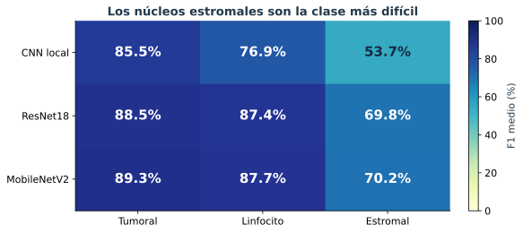
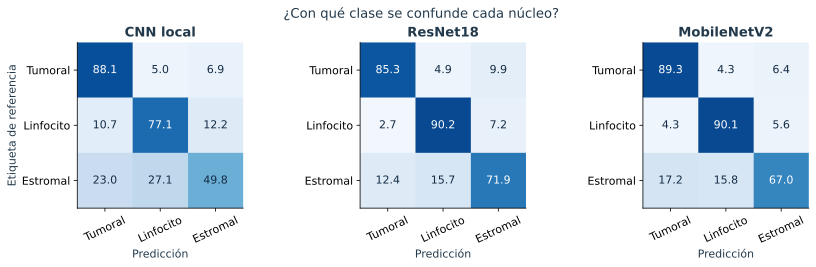
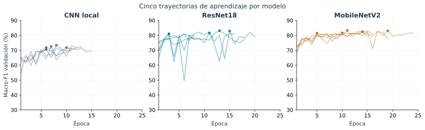
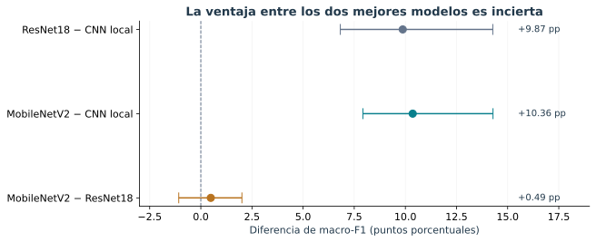

# Resultados verificados del piloto

**Estado:** quince corridas completas, cinco por modelo. Se recalcularon macro-F1 y matrices de confusión a partir de 3.571 predicciones por corrida; coinciden con los informes originales. Se verificaron identidad de recortes/pacientes/etiquetas entre corridas, probabilidades y mejor época.

## ¿Qué modelo clasifica mejor?

| Modelo | Macro-F1, media ± DE | Exactitud media | Parámetros |
|---|---:|---:|---:|
| CNN local | 72,03 ± 1,06 % | 76,62 % | 93.635 |
| ResNet18 | 81,91 ± 1,06 % | 84,18 % | 11.178.051 |
| MobileNetV2 | 82,39 ± 0,78 % | 85,02 % | 2.227.715 |

Los puntos muestran las cinco semillas; las barras indican dispersión entre entrenamientos, **no intervalos de confianza**. Todas las corridas usan los mismos 3.571 recortes de validación de 19 pacientes.

**Interpretación:** MobileNetV2 obtiene el mayor promedio observado, pero su ventaja sobre ResNet18 es 0,00488 de macro-F1 (0,49 puntos porcentuales), inferior al margen operativo preliminar de 0,02. Esto no demuestra equivalencia ni superioridad. Ambos superan descriptivamente a la CNN local.

## Resultados por clase

La clase estromal presenta el menor F1 promedio en los tres modelos. El análisis de errores debe priorizar esta categoría, sin atribuir automáticamente los fallos a ruido de anotación o mecanismos biológicos.

## ¿Dónde se producen los errores?

**Lectura:** cada fila corresponde a una clase de referencia y suma 100 %. La diagonal indica aciertos; las otras celdas muestran hacia dónde se desplazan los errores. Las cifras son porcentajes medios entre semillas, no conteos de pacientes independientes. Esta figura permite identificar confusiones que un promedio global oculta.

## Aprendizaje y costo

**Lectura:** las trayectorias se detienen en épocas distintas por parada temprana. El punto señala la época seleccionada con esta validación; no se interpreta como evidencia independiente del desempeño final.

| Modelo | Tiempo registrado medio por corrida |
|---|---:|
| CNN local | 16,7 min |
| ResNet18 | 33,9 min |
| MobileNetV2 | 44,4 min |

MobileNetV2 tiene menos parámetros que ResNet18, pero en estas corridas registró mayor tiempo. Una arquitectura compacta no garantiza menor duración en todos los equipos.

Los modelos paran en diferentes épocas. Los tiempos son los acumulados registrados por el entrenador en el Mac y pueden verse afectados por carga del equipo y reanudaciones; no constituyen un benchmark controlado de hardware. Los parámetros describen capacidad, no tiempo garantizado.

## Diferencias e incertidumbre exploratoria

**Lectura:** un valor positivo favorece al primer modelo. La línea vertical representa diferencia cero. El intervalo MobileNetV2–ResNet18 cruza cero: estos datos no permiten afirmar una ventaja clara de uno sobre el otro. Los intervalos son exploratorios y marginales, sin corrección múltiple.

| Comparación | Diferencia | IC exploratorio 95 % |
|---|---:|---:|
| ResNet18 − CNN local | +9,87 pp | +6,82 a +14,28 pp |
| MobileNetV2 − CNN local | +10,36 pp | +7,92 a +14,28 pp |
| MobileNetV2 − ResNet18 | +0,49 pp | −1,08 a +2,01 pp |

Se remuestrearon 19 pacientes con reemplazo, 5.000 veces; cada selección se aplicó de forma pareada a todos los modelos y semillas. Se recalculó macro-F1 agrupando las matrices de los pacientes seleccionados y se promedió sobre las cinco semillas fijas. Los IC percentiles marginales no tienen ajuste por comparaciones múltiples y no sustentan decisiones confirmatorias.

La validación ya seleccionó la mejor época: este remuestreo no elimina ese optimismo. Tampoco incorpora incertidumbre por reentrenar en nuevas muestras de entrenamiento. No se reportan pruebas confirmatorias ni equivalencia.

## Decisión para el siguiente experimento

El piloto permite estimar variación entre semillas y priorizar la comparación MobileNetV2–ResNet18. La selección bibliográfica de los tres baselines, el diseño con potencia suficiente y la protección del conjunto de prueba siguen pendientes. Las cinco semillas cumplen el mínimo del piloto, no garantizan potencia estadística.

Fuentes reproducibles: `resultados/`, `resultados_analizados/` y `scripts/analizar_piloto.py`. No se usaron imágenes de prueba/reserva.

Las figuras de esta presentación se reproducen con `python scripts/presentacion_visual.py`, después de `python scripts/analizar_piloto.py`. Las tablas numéricas completas permanecen en `resultados_analizados/`.
