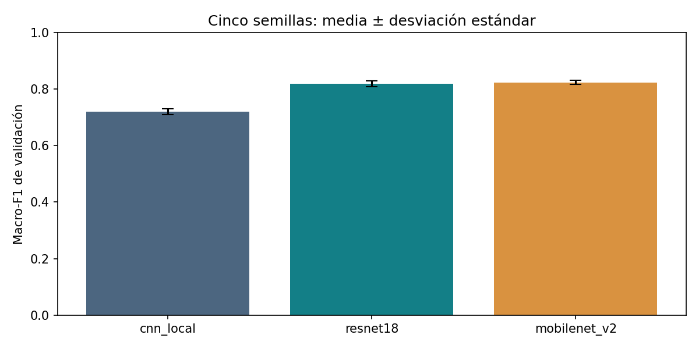
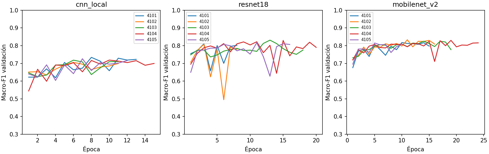

# Resultados verificados del piloto

**Estado:** quince corridas completas, cinco por modelo. Se recalcularon macro-F1 y matrices de confusión a partir de 3.571 predicciones por corrida; coinciden con los informes originales. Se verificaron identidad de recortes/pacientes/etiquetas entre corridas, probabilidades y mejor época.

| modelo       |      n |   macro_f1_media |   macro_f1_sd |   accuracy |   auc_macro |   minutos_media |    parametros |
|:-------------|-------:|-----------------:|--------------:|-----------:|------------:|----------------:|--------------:|
| cnn_local    | 5.0000 |           0.7203 |        0.0106 |     0.7662 |      0.8925 |         16.7327 |    93635.0000 |
| resnet18     | 5.0000 |           0.8191 |        0.0106 |     0.8418 |      0.9516 |         33.9134 | 11178051.0000 |
| mobilenet_v2 | 5.0000 |           0.8239 |        0.0078 |     0.8502 |      0.9531 |         44.3713 |  2227715.0000 |

**Interpretación:** MobileNetV2 obtiene el mayor promedio observado, pero su ventaja sobre ResNet18 es 0,00488 de macro-F1 (0,49 puntos porcentuales), inferior al margen operativo preliminar de 0,02. Esto no demuestra equivalencia ni superioridad. Ambos superan descriptivamente a la CNN local.

## Resultados por clase

|                                         |   mean |    std |
|:----------------------------------------|-------:|-------:|
| ('cnn_local', 'lymphocyte')             | 0.7688 | 0.0127 |
| ('cnn_local', 'nonTILnonMQ_stromal')    | 0.5369 | 0.0141 |
| ('cnn_local', 'tumor_nonMitotic')       | 0.8554 | 0.0124 |
| ('mobilenet_v2', 'lymphocyte')          | 0.8765 | 0.0050 |
| ('mobilenet_v2', 'nonTILnonMQ_stromal') | 0.7024 | 0.0149 |
| ('mobilenet_v2', 'tumor_nonMitotic')    | 0.8929 | 0.0091 |
| ('resnet18', 'lymphocyte')              | 0.8737 | 0.0095 |
| ('resnet18', 'nonTILnonMQ_stromal')     | 0.6985 | 0.0181 |
| ('resnet18', 'tumor_nonMitotic')        | 0.8850 | 0.0101 |

La clase estromal presenta el menor F1 promedio en los tres modelos. El análisis de errores debe priorizar esta categoría, sin atribuir automáticamente los fallos a ruido de anotación o mecanismos biológicos.

## Aprendizaje y costo

Los modelos paran en diferentes épocas. Los tiempos son los acumulados registrados por el entrenador en el Mac y pueden verse afectados por carga del equipo y reanudaciones; no constituyen un benchmark controlado de hardware. Los parámetros describen capacidad, no tiempo garantizado.

## Diferencias e incertidumbre exploratoria

|    | modelo_A     | modelo_B   |   diferencia |   ic95_inferior |   ic95_superior |
|---:|:-------------|:-----------|-------------:|----------------:|----------------:|
|  0 | resnet18     | cnn_local  |       0.0987 |          0.0682 |          0.1428 |
|  1 | mobilenet_v2 | cnn_local  |       0.1036 |          0.0792 |          0.1428 |
|  2 | mobilenet_v2 | resnet18   |       0.0049 |         -0.0108 |          0.0201 |

Se remuestrearon 19 pacientes con reemplazo, 5.000 veces; cada selección se aplicó de forma pareada a todos los modelos y semillas. Se recalculó macro-F1 agrupando las matrices de los pacientes seleccionados y se promedió sobre las cinco semillas fijas. Los IC percentiles marginales no tienen ajuste por comparaciones múltiples y no sustentan decisiones confirmatorias.

La validación ya seleccionó la mejor época: este remuestreo no elimina ese optimismo. Tampoco incorpora incertidumbre por reentrenar en nuevas muestras de entrenamiento. No se reportan pruebas confirmatorias ni equivalencia.

## Decisión para el siguiente experimento

El piloto permite estimar variación entre semillas y priorizar la comparación MobileNetV2–ResNet18. La selección bibliográfica de los tres baselines, el diseño con potencia suficiente y la protección del conjunto de prueba siguen pendientes. Las cinco semillas cumplen el mínimo del piloto, no garantizan potencia estadística.

Fuentes reproducibles: `resultados/`, `resultados_analizados/` y `scripts/analizar_piloto.py`. No se usaron imágenes de prueba/reserva.