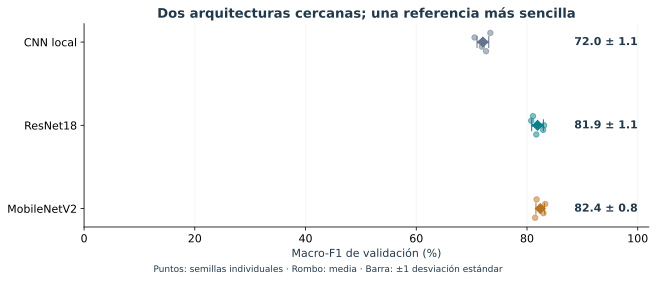
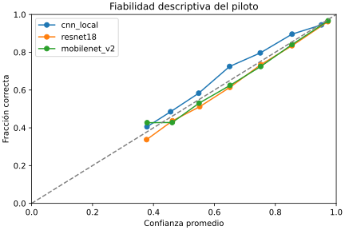
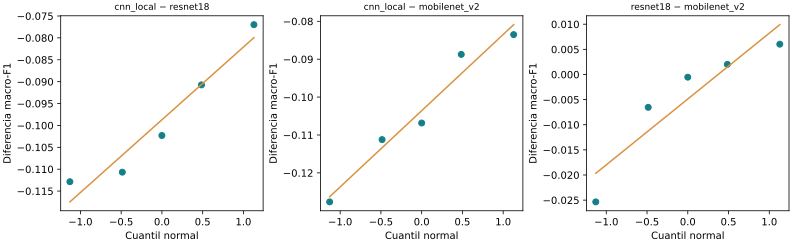

# Resultados verificados del piloto

El análisis comprende quince corridas completas, cinco por modelo. Se recalcularon macro-F1 y matrices de confusión a partir de 3.571 predicciones por corrida; coinciden con los informes originales. Se verificaron identidad de recortes/pacientes/etiquetas entre corridas, probabilidades y mejor época.

## ¿Qué modelo clasifica mejor?

| Modelo | Macro-F1, media ± DE | Exactitud media | Parámetros |
|---|---:|---:|---:|
| CNN local | 72,03 ± 1,06 % | 76,62 % | 93.635 |
| ResNet18 | 81,91 ± 1,06 % | 84,18 % | 11.178.051 |
| MobileNetV2 | 82,39 ± 0,78 % | 85,02 % | 2.227.715 |

Los puntos muestran las cinco semillas; las barras indican dispersión entre entrenamientos, **no intervalos de confianza**. Todas las corridas usan los mismos 3.571 recortes de validación de 19 pacientes.

**Interpretación:** MobileNetV2 obtiene el mayor promedio observado, pero su ventaja sobre ResNet18 es 0,00488 de macro-F1 (0,49 puntos porcentuales), inferior al margen operativo preliminar de 0,02. Esto no demuestra equivalencia ni superioridad. Ambos superan descriptivamente a la CNN local.

## Resultados por clase

La clase estromal presenta el menor F1 medio: 53,69% con la CNN local, 69,85% con ResNet18 y 70,24% con MobileNetV2. La mejora de MobileNetV2 respecto a la CNN local alcanza 16,56 puntos en esta categoría, frente a 10,77 en linfocitos y 3,75 en núcleos tumorales. La ganancia global se acompaña, por tanto, de una mejora especialmente marcada en la clase de menor desempeño, aunque no elimina la desigualdad entre categorías. Estas cifras no identifican la causa biológica o técnica de los errores.

## ¿Dónde se producen los errores?

**Lectura:** cada fila corresponde a una clase de referencia y suma 100 %. La diagonal indica aciertos; las otras celdas muestran hacia dónde se desplazan los errores. Las cifras son porcentajes medios entre semillas, no conteos de pacientes independientes. En la CNN local, el 49,85% de los núcleos estromales se clasifica correctamente, el 27,11% se asigna a linfocitos y el 23,05% a núcleos tumorales. ResNet18 eleva la sensibilidad estromal al 71,91%, frente al 66,97% de MobileNetV2. Por ello, el mayor F1 global de MobileNetV2 no implica mayor sensibilidad en todas las clases.

## Aprendizaje y costo

**Lectura:** las trayectorias se detienen en épocas distintas por parada temprana. Las mejores épocas se situaron entre la 6 y la 10 para la CNN local, entre la 3 y la 15 para ResNet18 y entre la 5 y la 19 para MobileNetV2. La variación entre semillas muestra que una duración fija corta no habría seleccionado el mismo punto de aprendizaje en todas las corridas. Estos máximos se eligieron con la propia validación y no constituyen evidencia independiente del desempeño final.

| Modelo | Tiempo registrado medio por corrida |
|---|---:|
| CNN local | 16,7 min |
| ResNet18 | 33,9 min |
| MobileNetV2 | 44,4 min |

MobileNetV2 tiene menos parámetros que ResNet18, pero en estas corridas registró mayor tiempo. Una arquitectura compacta no garantiza menor duración en todos los equipos.

Los modelos paran en diferentes épocas. Los tiempos son los acumulados registrados por el entrenador en el Mac y pueden verse afectados por carga del equipo y reanudaciones; no constituyen un benchmark controlado de hardware. Los parámetros describen capacidad, no tiempo garantizado.

## Diferencias e incertidumbre exploratoria

**Lectura:** un valor positivo favorece al primer modelo. La línea vertical representa diferencia cero. El intervalo MobileNetV2–ResNet18 cruza cero: estos datos no permiten afirmar una ventaja clara de uno sobre el otro. Los intervalos son exploratorios y marginales, sin corrección múltiple.

| Comparación | Diferencia | IC exploratorio 95 % |
|---|---:|---:|
| ResNet18 − CNN local | +9,87 pp | +6,82 a +14,28 pp |
| MobileNetV2 − CNN local | +10,36 pp | +7,92 a +14,28 pp |
| MobileNetV2 − ResNet18 | +0,49 pp | −1,08 a +2,01 pp |

Se remuestrearon 19 pacientes con reemplazo, 5.000 veces; cada selección se aplicó de forma pareada a todos los modelos y semillas. Se recalculó macro-F1 agrupando las matrices de los pacientes seleccionados y se promedió sobre las cinco semillas fijas. Los IC percentiles marginales no tienen ajuste por comparaciones múltiples y no sustentan decisiones confirmatorias.

La validación ya seleccionó la mejor época: este remuestreo no elimina ese optimismo. Tampoco incorpora incertidumbre por reentrenar en nuevas muestras de entrenamiento. No se reportan pruebas confirmatorias ni equivalencia.

## Síntesis de la comparación

El piloto distingue descriptivamente a ResNet18 y MobileNetV2 de la CNN local, pero no establece una ventaja concluyente entre las dos primeras. El [análisis estadístico](05_estadistica.md) muestra que cinco pares ofrecen sensibilidad limitada para diferencias de dos puntos porcentuales. La comparación sustenta una evaluación exploratoria de precisión, variabilidad y costo; no una selección confirmatoria de un modelo ganador.

Fuentes reproducibles: `resultados/`, `resultados_analizados/` y `scripts/analizar_piloto.py`. No se usaron imágenes de prueba/reserva.

Las figuras de esta presentación se reproducen con `python scripts/presentacion_visual.py`, después de `python scripts/analizar_piloto.py`. Las tablas numéricas completas permanecen en `resultados_analizados/`.

## Referencia descriptiva e intervalos entre semillas

MobileNetV2 constituye la referencia descriptiva del piloto por presentar la mayor media de macro-F1. Esta designación permite cuantificar el desempeño observado sin afirmar superioridad estadística ni convertirlo en uno de los tres modelos definitivos exigidos por la revisión bibliográfica.

| Modelo | Macro-F1, media ± DE | IC 95% t entre semillas | MCC | AP macro | ECE |
|---|---|---|---:|---:|---:|
| CNN local | 0,7203 ± 0,0106 | 0,7072–0,7335 | 0,6290 | 0,7862 | 0,0361 |
| ResNet18 | 0,8191 ± 0,0106 | 0,8059–0,8322 | 0,7544 | 0,8973 | 0,0198 |
| MobileNetV2 | 0,8239 ± 0,0078 | 0,8142–0,8336 | 0,7638 | 0,9020 | 0,0165 |

Los intervalos t describen variación entre cinco semillas sobre la misma validación. No sustituyen los intervalos agrupados por paciente ni eliminan el optimismo asociado a seleccionar checkpoints con esa validación. AP corresponde a *average precision*, promediada entre las tres clases; no es el área trapezoidal bajo la curva precisión–recobrado. MCC complementa la exactitud al considerar conjuntamente los aciertos y errores multiclase.

## Calibración de las probabilidades

El error de calibración esperado se calculó con diez intervalos uniformes de confianza. El gráfico agrupa las observaciones de las cinco semillas para describir confianza frente a fracción correcta; no representa un ensamble ni añade pacientes independientes. MobileNetV2 presenta el menor ECE promedio, aunque esta diferencia descriptiva no demuestra que sus probabilidades sean fiables en otra población. La pérdida de Brier multiclase fue 0,3314, 0,2268 y 0,2154 para CNN local, ResNet18 y MobileNetV2, respectivamente. No se aplicó recalibración.

## Comparaciones pareadas exploratorias

La prueba t pareada con corrección de Holm produjo p = 0,000366 para CNN local–ResNet18, p = 0,000405 para CNN local–MobileNetV2 y p = 0,4261 para ResNet18–MobileNetV2. Wilcoxon exacto produjo p ajustados de 0,1875, 0,1875 y 0,6250. La discrepancia refleja diferencias de supuestos y resolución con solo cinco pares; no se elige retrospectivamente el resultado más favorable.

Friedman produjo un estadístico de 7,60 y p asintótico de 0,0224. Este contraste global no identifica por sí solo qué par difiere y su aproximación es limitada con cinco bloques. Estos análisis son post hoc y no constituyen pruebas confirmatorias del nuevo diseño.

Shapiro–Wilk produjo p de 0,5347, 0,7400 y 0,2472 en las diferencias de los tres pares, en el orden anterior. La ausencia de rechazo no acredita normalidad con cinco observaciones. Los tamaños de efecto pareados y las coordenadas Q-Q se conservan en las tablas reproducibles. Su magnitud se refiere a la variabilidad entre semillas, no a un efecto clínico ni a variación poblacional entre pacientes.

El análisis se reproduce con `python scripts/estadistica_complementaria_piloto.py`. Las probabilidades exportadas se verificaron y renormalizaron por fila para corregir redondeo numérico. No se accedió a la reserva de la partición v2.
