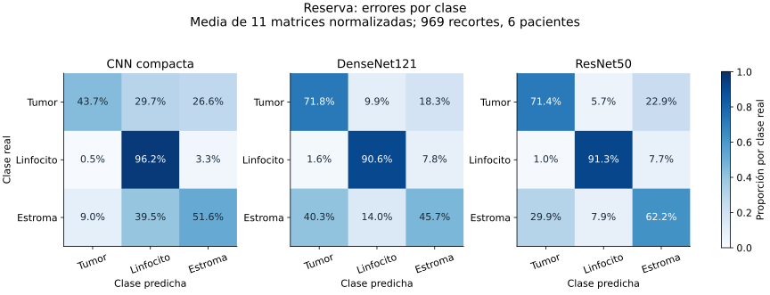
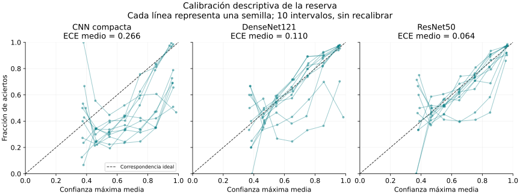
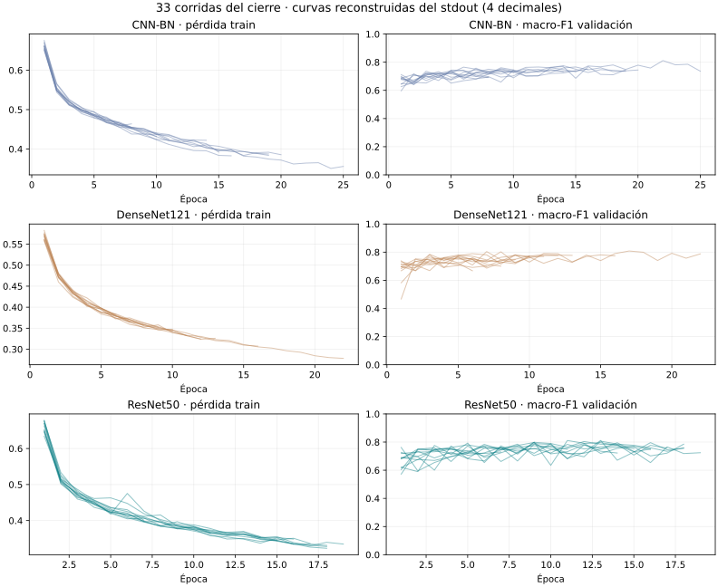

# Experimento V2: modelos y evidencia de ejecución

<!-- PRESENTACION_CAPITULO -->

05 / RESULTADOS

De la validación a la reserva

ResNet50 seleccionado por validaciónMacro-F1 reserva: 0,63811 semillas

<b>La generalización sigue siendo el desafío.</b> ResNet50 obtiene el mayor macro-F1 medio local, con una caída respecto a validación y F1 estromal de 0,302. Se conservan métricas por clase, incertidumbre y limitaciones.

<!-- FIN_PRESENTACION_CAPITULO -->

| Arquitectura | Parámetros entrenables, tres clases | Función |
|---|---:|---|
| CNN compacta con BatchNorm | 898.687 | Referencia de capacidad reducida |
| DenseNet121 | 6.956.931 | Conectividad densa |
| ResNet50 | 23.514.179 | Conectividad residual |

La comparación utiliza 14.539 recortes de entrenamiento y 2.049 de validación, con pacientes y TSS disjuntos. La reserva contiene 969 recortes de seis pacientes. La selección y el procedimiento se describen en la [metodología V2](04_metodologia_v2.md).

## Cierre de entrega del 8 de noviembre de 2026

Se verificó el ZIP de cierre con 33 archivos de predicciones y sus 33 resúmenes: once semillas consecutivas (6101–6111) por arquitectura. Cada archivo contiene los mismos 969 recortes y seis pacientes. Se reprodujeron las matrices de confusión y el macro-F1 a partir de las predicciones; sus huellas de checkpoints coinciden con el registro fijado antes de evaluar la reserva. El ZIP contiene resultados y huellas, no los pesos del entrenamiento: estos permanecen en la carpeta original de Drive.

El estado es `CIERRE_11_COMPLETADO_PLAN_22_PENDIENTE`. El plan calculó 22 semillas por modelo, pero la entrega se cerró con once por límite de tiempo, mediante una enmienda anterior a la evaluación de reserva. No se declara alcanzada la potencia de 0,80 del plan original. La comparación utiliza las primeras once semillas, sin selección por desempeño.

| Modelo | Macro-F1 validación, media ± DE | IC95 por semillas en validación | Macro-F1 reserva, media ± DE | Caída validación–reserva |
|---|---:|---:|---:|---:|
| CNN compacta BN | 0,7568 ± 0,0255 | [0,7397; 0,7739] | 0,4542 ± 0,0717 | 0,3026 |
| DenseNet121 | 0,7783 ± 0,0254 | [0,7612; 0,7953] | 0,6052 ± 0,1112 | 0,1730 |
| ResNet50 | 0,7934 ± 0,0173 | [0,7818; 0,8051] | 0,6378 ± 0,0518 | 0,1556 |

ResNet50 se seleccionó como referencia por su mayor media de validación, antes de abrir la reserva. Su mayor media en reserva es un resultado posterior y no el criterio de selección. Los intervalos de la tercera columna describen variación entre inicializaciones sobre una validación fija; no son intervalos de reserva ni de generalización entre pacientes.

Las tres redes se entrenaron desde cero. La búsqueda seleccionó lr=0,001 en las tres, con weight decay=0,0001 en la compacta y 0 en DenseNet121 y ResNet50. Se mantuvieron las condiciones comunes de la metodología: RGB128, normalización de entrenamiento, batch 32, máximo 25 épocas y parada temprana. El cierre reutilizó pesos guardados; no modificó hiperparámetros usando la reserva.

## Clases y dependencia por paciente en reserva

| Clase | Recortes | F1 compacta | F1 DenseNet121 | F1 ResNet50 |
|---|---:|---:|---:|---:|
| Tumoral no mitótica | 769 | 0,6003 | 0,7982 | 0,8123 |
| Linfocitaria | 130 | 0,5325 | 0,7655 | 0,7988 |
| Estromal | 70 | 0,2298 | 0,2520 | 0,3022 |

Cada F1 es la media de once ajustes evaluados sobre los mismos casos. El desempeño estromal es bajo en las tres redes. Se confirmó que 42 de los 70 recortes estromales proceden de un paciente. La reserva contiene seis pacientes con 9, 73, 332, 258, 142 y 155 recortes respectivamente; el promedio agrupado da más peso a quienes aportan más recortes y no equivale al promedio de seis macro-F1 individuales.

## Incertidumbre agrupada exploratoria

Se enumeraron las 46.656 remuestras ordenadas posibles de seis pacientes con reemplazo. En cada remuestra se conservaron juntos sus recortes, se calculó macro-F1 por ajuste y se promediaron los once ajustes fijos. Se usaron tres clases fijas y cero para denominadores nulos. Los percentiles proporcionan estos intervalos exploratorios:

| Modelo | Media observada | Intervalo percentil 95 por pacientes |
|---|---:|---:|
| CNN compacta BN | 0,4542 | [0,2586; 0,5716] |
| DenseNet121 | 0,6052 | [0,4415; 0,6738] |
| ResNet50 | 0,6378 | [0,4603; 0,7167] |

Para ResNet50 menos DenseNet121, la diferencia observada es 0,0325 y el intervalo pareado exploratorio 95 es [0,0015; 0,0618]. Este intervalo nominal no está ajustado por las tres comparaciones, depende de solo seis pacientes y condiciona a los once ajustes disponibles. Su extremo inferior no supera el margen operativo de 0,02; no acredita una mejora práctica de al menos dos puntos ni una superioridad poblacional confirmatoria. El remuestreo no reproduce el entrenamiento, no aumenta el número de pacientes y no es un ensayo de validación externa independiente.

## Métricas complementarias de reserva

Calculadas después del cierre sobre las probabilidades guardadas, sin entrenar, modificar umbrales ni recalibrar. Se informa la media de once métricas individuales; no es un ensemble. La dispersión por semilla y los valores completos están en `metricas_reserva_por_semilla.csv` y `metricas_complementarias.json`.

| Modelo | Exactitud | Exactitud balanceada | MCC | AUC macro OvR | AP macro OvR | Brier | ECE |
|---|---:|---:|---:|---:|---:|---:|---:|
| CNN compacta BN | 0,5135 | 0,6384 | 0,3497 | 0,8276 | 0,6394 | 0,7135 | 0,2662 |
| DenseNet121 | 0,7246 | 0,6937 | 0,5123 | 0,8631 | 0,7042 | 0,4089 | 0,1103 |
| ResNet50 | 0,7342 | 0,7496 | 0,5255 | 0,9024 | 0,7378 | 0,3582 | 0,0645 |

AUC se calcula por clase frente al resto y se promedia sin ponderar. AP es *average precision*, no área trapezoidal bajo la curva precisión–recall. Brier suma el error cuadrático de las tres probabilidades por recorte y luego promedia (rango 0–2; menor es mejor). ECE utiliza diez intervalos iguales de confianza máxima; depende del particionado y no acredita calibración de cada clase. Estas son medidas descriptivas de la misma reserva de seis pacientes; no proporcionan 969 observaciones independientes para inferencia.

La matriz muestra el origen de muchos falsos positivos estromales: ResNet50 asigna a estroma el 22,9% de los recortes tumorales, mientras recupera el 62,2% del estroma real. Como hay 769 recortes tumorales frente a 70 estromales, la sensibilidad estromal no basta para garantizar precisión ni F1 altos. La AUC elevada tampoco sustituye la evaluación de la decisión final por clase.

Cada curva corresponde a un ajuste; los intervalos vacíos se omiten y los conteos se conservan en el JSON. Una curva bajo la diagonal indica confianza superior a la fracción de aciertos. ResNet50 presenta menor ECE medio en este conjunto, pero las curvas muestran variación entre semillas. No se ajustó una calibración usando estos resultados.

## Evidencia y trabajo pendiente

Los resultados agregados y el análisis reproducible están en `resultados_analizados/cierre_11`. El cuaderno ejecutado de Colab debe acompañar la entrega; la comprobación del ZIP no demuestra por sí sola que ese cuaderno esté adjunto. Las curvas y los pesos se conservan en el entrenamiento original y no se reconstruyen a partir de este ZIP.

Quedan pendientes la ampliación a 22 según el plan, la inferencia conjunta de semillas y pacientes, la galería de errores/Grad-CAM y la medición controlada de latencia. Ninguno de estos elementos se presenta como ya completado. La ampliación posterior mantendrá arquitectura e hiperparámetros fijados antes de la reserva.

## Separación del experimento anterior

Las corridas de CNN local, ResNet18 y MobileNetV2 corresponden al [piloto histórico](08_resultados_piloto.md). No se mezclan con los resultados V2.

## Evidencia ejecutada y curvas recuperadas

El [notebook ejecutado](https://github.com/aduartech81/NuCLS_DeepLearning/blob/main/colab/Experimento_NuCLS_v2_ejecutado_cierre11.ipynb) conserva salidas en diez celdas de código y 805 registros de épocas: búsqueda (12 configuraciones), piloto V2 (15 corridas), cierre (33 corridas) y la semilla 6112 excluida. No se han rellenado artificialmente los contadores de ejecución faltantes. La procedencia y el hash se conservan en `procedencia_stdout.json`.

Cada línea es una corrida; el final de la línea refleja parada temprana. Las métricas están redondeadas como en stdout. El máximo por corrida aproxima el checkpoint seleccionado; puede no resolver empates por redondeo.

| modelo | corridas | epocas | minutos_epocas |
|---|---|---|---|
| densenet121 | 11 | 124 | 226.9 |
| resnet50 | 11 | 169 | 297.8 |
| softmaxcnn_bn | 11 | 165 | 142.4 |

Los tiempos suman épocas de entrenamiento y validación; no incluyen todos los gastos de guardado, preparación y ejecución. **No son latencia de inferencia ni duración total de la sesión.** Los CSV permiten consultar cada corrida, las cuatro configuraciones por modelo y las cinco semillas piloto.

La [comparación estadística](05_estadistica.md) presenta Holm, efectos, Friedman/Nemenyi, normalidad, McNemar diagnóstico y AUC agrupada. ResNet50 sigue siendo el baseline por validación; no se afirma superioridad sobre DenseNet121 entre semillas de reserva. La robustez por paciente/TSS y exclusión de grupos está en los CSV de auditoría.
