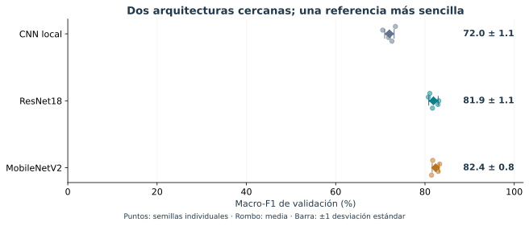

# Aprendizaje profundo para clasificar núcleos

**Andrés Duarte Chaves · Maestría en Ingeniería Biomédica · Deep Learning**

NuCLS · Entregable 1 · Estudio exploratorio

<h2>De una imagen nuclear a una predicción de clase</h2>

Comparamos tres redes neuronales para distinguir núcleos tumorales no mitóticos, linfocitos y núcleos estromales anotados. La pregunta central es cuánto mejora la clasificación al cambiar de arquitectura y cuán estable es esa mejora.

<strong>17.999</strong>recortes: 14.428 de entrenamiento y 3.571 de validación

<strong>98</strong>pacientes: 79 de entrenamiento y 19 de validación

<strong>15</strong>entrenamientos: tres modelos × cinco semillas

## Primero, veamos las imágenes

**La etiqueta corresponde al núcleo objetivo de cada recorte.** La imagen puede contener otros núcleos y fondo. Esta galería ilustra la entrada del clasificador; no presenta predicciones. [Explorar imágenes, procedencia y preparación](02_galeria.md).

## El hallazgo principal

**MobileNetV2 y ResNet18 alcanzan resultados cercanos.** La diferencia promedio es de 0,49 puntos porcentuales de macro-F1. La CNN local presenta menor desempeño y la clase estromal es la más difícil para las tres arquitecturas.

<strong>Cómo leer estos resultados.</strong> Son resultados de validación de un piloto; esta misma partición seleccionó las mejores épocas. No representan desempeño confirmado en pacientes nuevos ni una demostración de superioridad clínica.

## Elige cómo explorar el trabajo

<strong>Entender</strong>Problema, imágenes y hallazgo principal.
<a href="02_galeria.html">Ver qué recibe la red →</a>

<strong>Evaluar</strong>Diseño, resultados, incertidumbre y conclusiones.
<a href="08_resultados_piloto.html">Examinar resultados →</a>

<strong>Reproducir</strong>Notebook ejecutado y evidencia numérica.
<a href="07_analisis_ejecutado.html">Abrir análisis →</a>

## Recorrido del informe

- **[Problema y alcance](01_problema.md):** qué predice el modelo y cuál es su unidad de análisis.
- **[EDA y preprocesamiento](02_resultados_eda.md):** balance, selección de recortes y calidad de imagen, con decisiones derivadas de los datos.
- **[Estado del arte](03_literatura.md):** antecedentes y fundamento de las arquitecturas candidatas; revisión todavía preliminar.
- **[Resultados del piloto](08_resultados_piloto.md):** desempeño, errores por clase, aprendizaje, costo e incertidumbre.
- **[Discusión y conclusiones](09_discusion.md):** qué se puede defender y qué limita la generalización.
- **[Análisis ejecutado](07_analisis_ejecutado.ipynb):** cálculos reproducibles y evidencia de ejecución.

## Alcance científico

La entrada es un recorte centrado en un núcleo previamente anotado, no una lámina completa. El sistema clasifica las tres categorías seleccionadas de NuCLS: no detecta automáticamente todos los núcleos ni identifica telocitos. La investigación utiliza datos histológicos anotados disponibles y mantiene separadas estas tareas.

El piloto está completo. La justificación bibliográfica definitiva de los tres baselines y el experimento confirmatorio aún requieren desarrollo; los capítulos metodológicos explican sus límites sin atribuir al estudio resultados que no se han obtenido.
