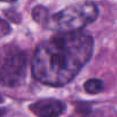
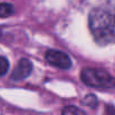
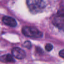
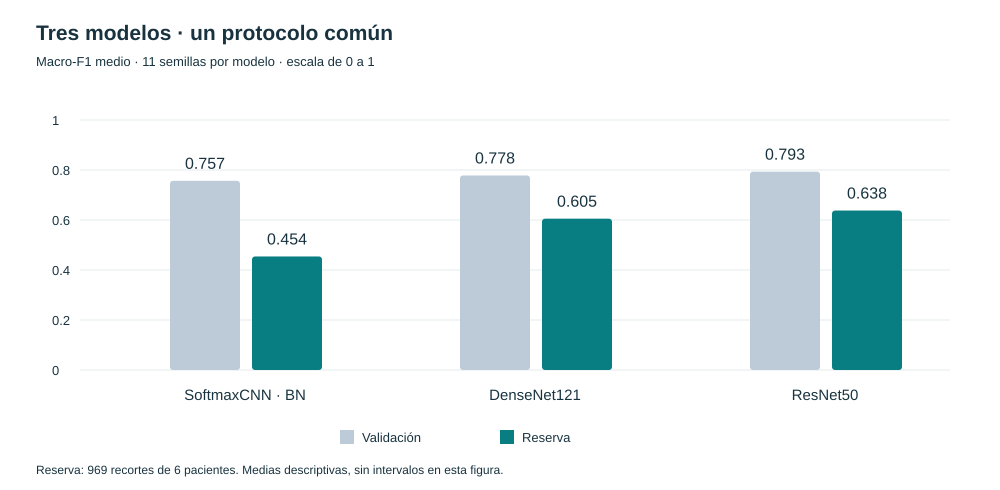

# NuCLS · Evidencia, datos y modelos

INGENIERÍA BIOMÉDICA / DEEP LEARNING

<h2>De la morfología nuclear <em>a la evidencia experimental.</em></h2>

Clasificación de núcleos tumorales, linfocitarios y estromales. Una comparación de tres modelos base conectada con la literatura, la calidad de los datos y la evaluación por paciente.

Andrés Duarte Chaves · Entregable 1 · 8 de noviembre de 2026

<a class="book-button" href="08_resultados_v2.html">Explorar los resultados →</a><a class="book-button secondary" href="https://nucls-andres-duarte.onrender.com/">Dashboard interactivo ↗</a>

<figure><figcaption>Tumoral</figcaption></figure>
<figure><figcaption>Linfocito</figcaption></figure>
<figure><figcaption>Estromal</figcaption></figure>

H&E · RGB 128 × 128 Ejemplos ilustrativos de entrenamiento, no predicciones.

DESARROLLO<strong>16.588</strong><small>104 pacientes · entrenamiento y validación</small>

RESERVA<strong>969</strong><small>6 pacientes · evaluación final</small>

EXPERIMENTO<strong>33</strong><small>11 semillas por cada uno de los 3 modelos</small>

LITERATURA<strong>166</strong><small>informes con lectura dirigida documentada</small>

## Tres recorridos para evaluar el proyecto

<a class="book-route" href="03_literatura.html">01 / ESTADO DEL ARTE<h3>De la búsqueda al diseño</h3>
Síntesis crítica, comparadores exactos, diferencias de tarea y flujo documental adaptado de PRISMA.
<strong>1.330 registros cribados · 21 informes focales</strong>Leer la evidencia →</a>
<a class="book-route" href="02_desarrollo_v2.html">02 / ANÁLISIS EXPLORATORIO<h3>Entender la muestra</h3>
Integridad, balance, selección espacial, similitud entre recortes, heterogeneidad y desplazamiento.
<strong>83 pacientes de entrenamiento · 21 de validación</strong>Explorar el EDA →</a>
<a class="book-route" href="04_metodologia_v2.html">03 / IMPLEMENTACIÓN<h3>Comparar en condiciones comunes</h3>
CNN compacta con BN, DenseNet121 y ResNet50; arquitectura, entrenamiento, selección y reproducibilidad.
<strong>Inicialización desde cero · entrada RGB común</strong>Examinar los modelos →</a>

## Resultado principal: el reto de generalizar

ResNet50 obtuvo el mayor macro-F1 medio en validación y fue seleccionado antes de evaluar la reserva. El cierre incorpora **11 semillas por modelo**, las predicciones de reserva y un análisis exploratorio agrupado por paciente.

DESEMPEÑO EN RESERVA<h3>0,638 · ResNet50</h3>
Frente a 0,605 de DenseNet121 y 0,454 de la CNN compacta. Son medias del mismo experimento local; no una clasificación universal de arquitecturas.

CLASE MÁS DIFÍCIL<h3>0,302 · F1 estromal</h3>
La reserva contiene 70 recortes estromales y 42 pertenecen a un solo paciente. El promedio global no elimina esta fragilidad.

Los [resultados completos](08_resultados_v2.md) distinguen variación entre semillas de incertidumbre entre pacientes. Los intervalos agrupados son exploratorios y condicionados a los ajustes disponibles. La [discusión](09_discusion.md) relaciona estos resultados con la evidencia bibliográfica y el EDA.

## Un protocolo que conserva la trazabilidad

<b>1</b><h3>Definir la tarea</h3>
Clasificar un núcleo ya localizado, con tres categorías y ventanas interiores elegibles.

<b>2</b><h3>Separar pacientes</h3>
Desarrollo: 14.539 recortes de entrenamiento y 2.049 de validación. Reserva separada.

<b>3</b><h3>Seleccionar con validación</h3>
Mismo protocolo local y búsqueda documentada. ResNet50 seleccionado antes de la reserva.

<b>4</b><h3>Evaluar y declarar límites</h3>
Resultados por clase, semillas y pacientes, con las restricciones del cierre académico.

<strong>Alcance del cierre de entrega</strong>
13 informes no recuperados al corte y un duplicado tardío documentado. Revisión crítica dirigida, sin segundo revisor independiente; no revisión sistemática exhaustiva. El experimento se cierra con 11 de las 22 semillas previstas por modelo. Concordancia entre anotadores, Grad-CAM y latencia controlada permanecen pendientes.

## Evidencia para profundizar

- [Notebook EDA ejecutado](10_eda_v2.ipynb): cálculos y salidas del análisis exploratorio.
- [Galería de entrenamiento](02_galeria.md): representación de entrada y etiquetas ilustrativas.
- [Comparación estadística](05_estadistica.md): unidades de análisis, selección e incertidumbre.
- [Repositorio de código y evidencias](https://github.com/aduartech81/NuCLS_DeepLearning): implementaciones, matrices bibliográficas y resultados derivados.
- [Dashboard interactivo](https://nucls-andres-duarte.onrender.com/): exploración de métricas, clases y artículos.

Los anexos históricos conservan el piloto anterior de CNN local, ResNet18 y MobileNetV2. No sustituyen la comparación V2 ni se mezclan con sus resultados. Este proyecto estudia clasificación de recortes previamente localizados; no valida detección en láminas completas ni uso clínico.
